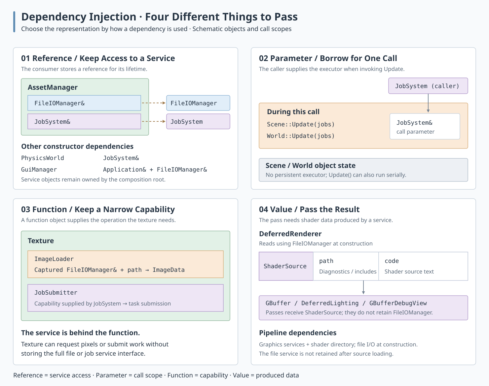
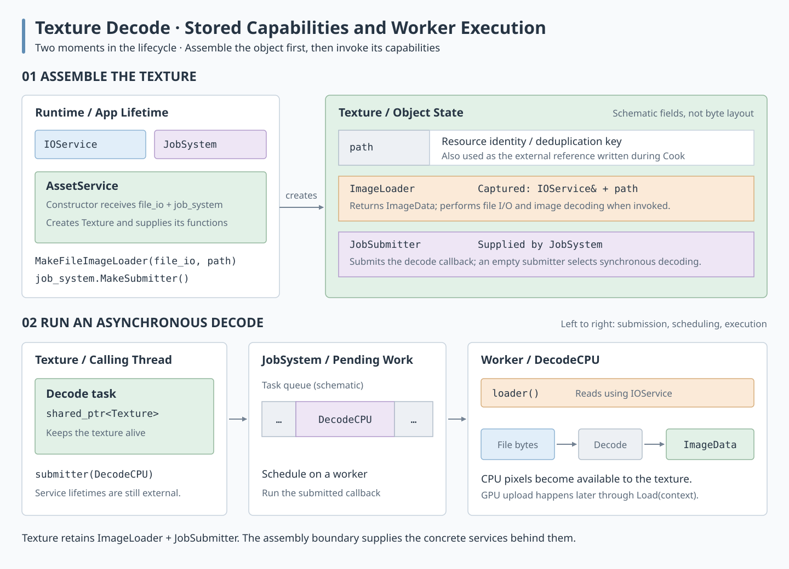
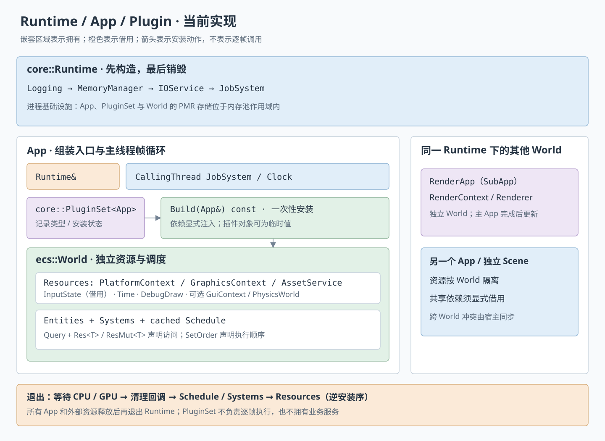

# Dependency injection

Hitagi modules declare dependencies through constructor arguments, operation parameters, function objects, and data values. The caller supplies each dependency at the boundary where it is used.

`Engine` is the composition root for an engine instance: it creates runtime services, assembles the module tree, and owns their lifetimes. Tests and standalone tools assemble their own services according to the same lifetime rules.

## Four injection shapes

The injection shape follows how the consumer uses the dependency:

| Shape | When to use it | Examples |
| --- | --- | --- |
| Constructor injection (reference) | The object needs access to a service, or data backed by that service, throughout its lifetime | `AssetManager(FileIOManager&, JobSystem&)`, `PhysicsWorld(JobSystem&)`, `GuiManager(Application&, FileIOManager&)` |
| Call injection (parameter) | A particular operation needs a service the caller already has | `World::Update(JobSystem&)`, `Scene::Update(JobSystem&)`, `Resource::Load(const ResourceLoadContext&)` |
| Capability injection (function object) | The consumer needs a specific operation supplied by a service | `ImageLoader` obtains pixels; `JobSubmitter` submits a task |
| Value injection (data) | The consumer needs the result produced by a service | `render::ShaderSource` carries source text and its path |



### Constructor injection: services for an object's lifetime

`AssetManager` receives `FileIOManager&` and `JobSystem&` in its constructor and stores those references. Its owner creates the services first and destroys the manager before them:

```cpp
hitagi::core::FileIOManager file_io;
hitagi::core::JobSystem job_system;
hitagi::asset::AssetManager assets(file_io, job_system, "assets");
```

`PhysicsWorld` receives a `JobSystem&` for simulation work. `GuiManager` receives `Application&` for application and input access, and `FileIOManager&` to load fonts. Its font atlas retains pointers into the file cache, so the file service must outlive the GUI manager even though font loading occurs during construction.

### Call injection: an executor for one update

`ecs::World` receives an executor when running a parallel update. Its public update interface is:

```cpp
class World {
public:
    explicit World(std::string_view name);
    void Update();                         // serial execution on the calling thread
    void Update(core::JobSystem& jobs);     // parallel execution through the supplied executor
    // Other declarations omitted.
};
```

Both overloads run the same validated dependency graph. Serial execution follows its topological order; parallel execution uses Taskflow to schedule independent work.

Scene construction, cooked parsing, USD import, and editor command do/undo can use serial updates without a thread pool. Frame updates can call `Update(engine.Jobs())`. `asset::Scene` exposes the same choice for updating its world. See [ECS contracts](ecs.md) for scheduling and structural-update rules.

GPU resource loading also receives services per operation:

```cpp
struct ResourceLoadContext {
    gfx::Device& device;
    gfx::CommandQueues& queues;
    gfx::BindlessUtils& bindings;
    const gfx::ShaderCompiler& shader_compiler;
};
```

`Resource::Load(const ResourceLoadContext&)` uses this context to create or upload GPU resources. `Engine::ResourceLoadContext()` assembles the references for application callers. The services must outlive the GPU resources created through them.

### Capability injection: texture loading and task submission

A lazily loaded texture receives functions for obtaining CPU pixels and submitting decode work:

```cpp
using ImageLoader = std::function<ImageData()>;

Texture(std::filesystem::path path,
        ImageLoader loader,
        std::string_view name = "",
        core::JobSubmitter decode_submitter = {});
```

`path` identifies the resource for deduplication and cooked references. `ImageLoader` supplies the pixels. `JobSubmitter` supplies asynchronous execution; an empty submitter selects synchronous decoding.

`AssetManager` creates these capabilities from its injected services:

```cpp
std::make_shared<Texture>(
    key,
    MakeFileImageLoader(m_FileIO, key),
    name,
    m_JobSystem.MakeSubmitter());
```

`MakeFileImageLoader` captures `FileIOManager&` and the path. When invoked, it reads the bytes and passes them to an image codec. The codec operates on buffers and image data; the loader owns the file-reading step.

On the asynchronous path, the submitted task holds a `shared_ptr<Texture>` and invokes `DecodeCPU` on a worker. Decoding produces CPU data; GPU upload occurs through a later `Load(context)` call. Asynchronous decoding requires both a submitter and shared ownership of the texture; otherwise decoding runs synchronously.



### Value injection: shader source for a render pass

Render passes receive shader source as a value:

```cpp
struct ShaderSource {
    std::filesystem::path path;   // diagnostics and relative #include resolution
    std::pmr::string code;
};
```

The optional `preset.deferred` renderer reads its sources with `render::LoadShaderSource(file_io, path)` during construction. It then passes `ShaderSource` values to `GBuffer`, `DeferredLighting`, and `GBufferDebugView`, alongside their device, binding, and compiler references.

The passes retain shader data and graphics dependencies. File access belongs to the assembly step, and `DeferredRenderer` does not retain `FileIOManager&` after construction. Editor viewport passes use the same value-injection pattern.

## Engine composition

`Engine` owns infrastructure services and the runtime module tree. The host supplies `AppConfig`, attaches game or editor modules, and selects a renderer.



Nested containers show ownership. Amber labels identify borrowed dependencies or explicitly marked creation inputs. The strip below the containers shows destruction order.

### Infrastructure and module ownership

`MemoryManager`, `FileIOManager`, and `JobSystem` are owned by `Engine` members. They are outside the ticked module subtree, and member declaration order determines their lifetime.

The runtime subtree owns application, graphics, asset, physics, logic, rendering, and GUI modules. `RuntimeModule::Tick()` visits children in tree order. `Engine::AddSubModule` mounts game and editor modules under `OutLogicArea`.

The initial assembly order is:

```text
Engine construction
  members: MemoryManager → FileIOManager → JobSystem
  subtree: App → Device → GraphicsServices → Assets → Physics
           → OutLogicArea → Debug → ClearRenderer → Gui → RenderRuntime

~Engine
  UnloadAllSubModules(): RenderRuntime → ... → App
  member destruction: JobSystem → FileIOManager → MemoryManager
```

`GraphicsServices` owns command queues, bindings, and the shader compiler. Graphics consumers receive the individual facilities they need. GPU resource creation receives the device, allocator, or binding facilities required by the relevant `Create` API. See the [gfx contracts](../../hitagi/gfx/AGENT.md) for graphics ownership and destruction requirements.

### Application access to services

Game and editor application code obtains services through the `Engine&` it holds:

| Use | Engine accessors |
| --- | --- |
| Infrastructure | `FileIO()`, `Jobs()` |
| Application and simulation | `App()`, `Physics()` |
| Graphics facilities | `Device()`, `Queues()`, `Bindings()`, `ShaderCompiler()` |
| Resources and rendering | `Assets()`, `Renderer()`, `RenderRuntime()`, `ResourceLoadContext()` |
| GUI | `GuiManager()` |

The application layer can use the complete engine to assemble workflows. Modules inside the engine receive the specific dependencies they consume. `Engine` starts with `ClearRenderer`; the host selects another renderer through `SetRenderer`. See [Overall abstraction design](overview.md) for the engine, editor, and game boundaries.

## Lifetime rules

A borrowed reference, including one captured by a function object, does not extend the referenced object's lifetime. The owner must keep services alive for all consumers and outstanding work.

* `Engine::~Engine()` tears down the runtime subtree before its infrastructure members are destroyed.
* Graphics consumers must be destroyed before bindings and queues; those facilities must be destroyed before the device.
* `MakeFileImageLoader` captures `FileIOManager&`, and `JobSystem::MakeSubmitter()` captures the job system. Both services must outlive textures holding those capabilities.
* A decode task's `shared_ptr<Texture>` keeps the texture alive while the task runs. It does not extend the lifetime of the injected file or job services.
* `JobSystem` waits for outstanding work during destruction. The file service remains alive until after that wait because it is declared before the job system.
* A parallel ECS schedule uses the supplied job system for that run and clears its temporary executor pointer when the run ends.

Resource registries in `AssetManager` hold weak references for lookup and deduplication. Actual ownership follows the resource graph and its consumers. Callers retaining resources outside the module tree must ensure their injected services remain alive; destroying an engine does not invalidate or release an external `shared_ptr` automatically. See [Resource lifecycle](../assets/resource_lifecycle.md).

## Tests and standalone tools

The unit-test entry point owns the process-wide `MemoryManager` that installs the default PMR resource. Fixtures own the additional services their tests require, in dependency order:

```cpp
class AssetManagerTest : public ::testing::Test {
protected:
    hitagi::core::FileIOManager file_io;
    hitagi::core::JobSystem job_system;
    hitagi::asset::AssetManager assets{file_io, job_system, "assets"};
};
```

The fixture destroys `assets` first, followed by `job_system` and `file_io`. ECS tests can construct `World(name)` and call serial `Update()`; parallel tests supply a job system. Render-pass tests can supply shader source values directly.

A standalone tool composes services in the same way. The PBR cook command uses this declaration order:

```cpp
hitagi::core::MemoryManager memory_manager;
hitagi::core::FileIOManager file_io;
hitagi::core::JobSystem job_system;
hitagi::asset::AssetManager asset_manager(file_io, job_system, "assets");
```

This assembly supports asset work without an interactive engine or editor instance.

## Source entry points

* Engine assembly and accessors: [engine.cpp](../../hitagi/engine/engine.cpp), [engine.cppm](../../hitagi/engine/engine.cppm)
* Runtime module ownership and tick order: [runtime_module.cpp](../../hitagi/core/runtime_module.cpp)
* Asset service injection and texture capabilities: [asset_manager.cpp](../../hitagi/asset/asset_manager.cpp), [texture.cpp](../../hitagi/asset/texture.cpp)
* Executor capability: [job_system.cpp](../../hitagi/core/job_system.cpp)
* ECS update and execution: [world.cpp](../../hitagi/ecs/world.cpp), [schedule.cpp](../../hitagi/ecs/schedule.cpp)
* Shader values and preset assembly: [types.cpp](../../hitagi/render/types.cpp), [deferred_renderer.cpp](../../presets/deferred/deferred_renderer.cpp)
* Standalone cook composition: [PBR editor entry point](../../examples/pbr_demo/editor.cpp)
