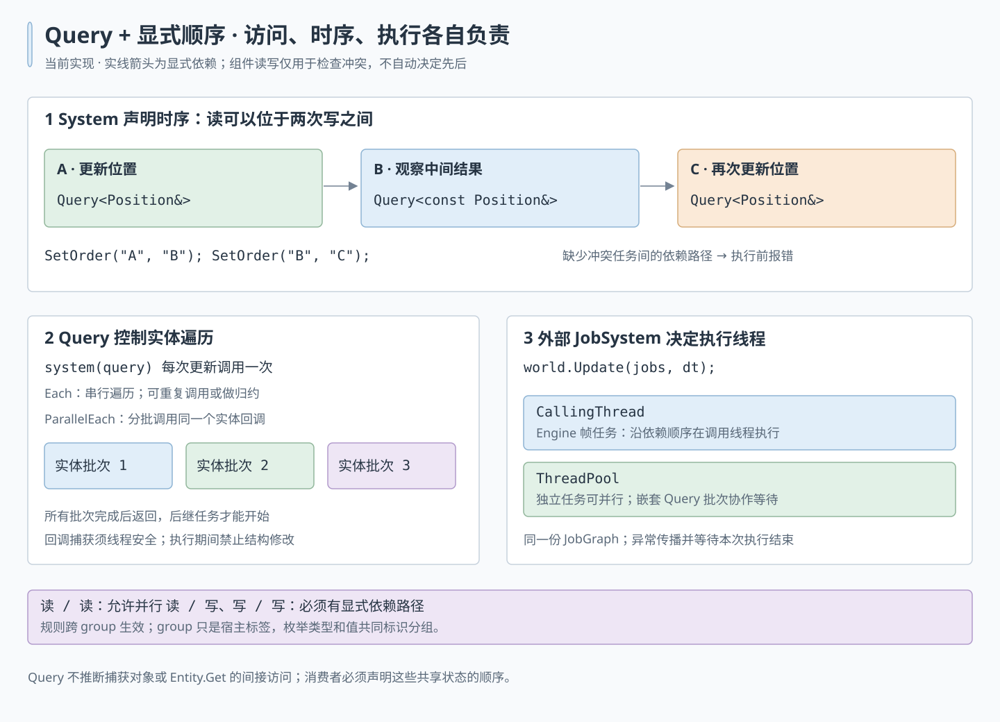

# ECS ownership and update contracts

## Public usage

```cpp
core::JobSystem job_system;
ecs::World world("game");
world.RegisterSystem<MovementSystem, TransformSystem>();

ecs::Entity entity = world.GetEntityManager().Create();
entity.Emplace<Transform>();
Transform& transform = entity.Get<Transform>();

world.Update(job_system);  // waits for completion

world.GetSystemManager().Disable<MovementSystem>();
world.GetSystemManager().Enable<MovementSystem>();
world.GetSystemManager().Unregister<MovementSystem>();
```

`Update(job_system, delta_seconds)` accepts a frame duration in seconds. It
defaults to zero and must be finite and nonnegative. Tasks read
`schedule.GetDeltaSeconds()` during execution, not when declaring the cached
schedule. The update waits for the supplied job system and propagates task
exceptions. It does not roll back component writes made before an exception. [Skeletal animation](../assets/animation.md) uses this frame duration
and explicit ordering for cross-entity animation and skinning bindings.

`World(name, configure_schedule)` optionally retains a host configuration callback.
It runs before system configuration on every schedule rebuild, not on every frame.
Use it for stable group ordering or host tasks. Failed configuration discards the
candidate schedule and is retried on the next Update. ECS has no built-in frame
stage enum; engine's frame policy lives in `engine:frame_stages`.

`World::RegisterSystem<T>(constructor_args...)` also supports stateful systems
and returns a borrowed reference to the instance. Registering the same type
again enables and returns the existing instance without constructing another.
Static hooks and variadic default registration remain supported. World is the
instance owner; callbacks and cached tasks retain the instance for their lifetime.
If OnCreate throws, registration removes that instance; component writes already
performed by the callback are not rolled back.

There is one execution entry: `Update(job_system, delta_seconds)`. The host
chooses `JobSystem::Execution::CallingThread` for frame work or a thread pool for
simulation. The World never creates an executor or selects a thread policy.
See [runtime scheduling](runtime_schedule.md) for Engine integration.

Registration moved from `GetSystemManager().Register<T>()` to
`World::RegisterSystem<T>()`. Entity access, bulk creation, dynamic components,
filters, `Schedule::Request()` chaining and `Schedule::SetOrder()` remain available.
Component callbacks now take a Query value rather than one entity’s components. System lifecycle hooks still receive `World&`; `ConfigureSchedule`
receives `Schedule&` and declares tasks. Schedule is now constructed by World
and no longer exposes a `world` reference. Capture required dependencies when
binding system state rather than resolving them through the scheduler.

## Query and explicit order

```cpp
struct MovementSystem {
    void ConfigureSchedule(ecs::Schedule& schedule) {
        schedule.Request("move", [](ecs::Query<Position&, const Velocity&> query) {
            query.ParallelEach([](Position& position, const Velocity& velocity) {
                position.value += velocity.value;
            });
        });
        schedule.Request("observe", [](ecs::Query<const Position&> query) {
            query.Each([](const Position& position) { Observe(position); });
        });
        schedule.SetOrder("move", "observe");
    }
};
```

The example assumes application-defined Position/Velocity/Observe. A read can be
ordered between two writers (`first -> observe -> last`); registration order and
constness do not move that read before or after all writers. Query callbacks may
perform multiple traversals, reductions, or whole-system setup/teardown.



## Ownership and dependency boundaries

- World owns the entity manager, system registry and cached schedule.
- EntityManager owns the internal EntityStorage and constructs Entity handles.
  Handles contain a non-owning storage pointer and an ID. They must not outlive
  their World. A manager rejects handles belonging to another storage.
- EntityStorage owns component metadata, archetypes and entity locations. It
  does not depend on Entity, EntityManager or World. EntityManager registers the
  Entity component using the same metadata path as other static components.
- Component descriptions are registered once, never replaced, and outlive the
  archetypes. Each archetype column references its description and stores only
  its layout offset. Canonical sorted component-ID sequences identify archetypes;
  hash collisions are resolved by comparing the complete sequences.
- Archetype owns its chunks and both ID-to-row and dense row-to-ID metadata.
  Swap-removal updates both mappings. It does not read an Entity object to find
  the last row, so compaction does not depend on a component object's lifetime.
- Schedule receives EntityStorage, a logger and a debug name. It invokes each
  callback once per update, including callbacks whose Query is empty. Query
  traversals visit matching archetypes and chunks using fixed-size column arrays.
  Filters are evaluated on every traversal; no matches or task buffer addresses
  are cached across updates.
- SystemManager retains its public name but acts as a registry. It stores
  already-bound lifecycle callbacks with no World parameter, plus update
  callbacks taking Schedule and owned system state. World performs lifecycle binding at registration.
  Registry and scheduler implementations never call back into World directly.

The interface-partition import graph is acyclic. Query owns traversal and
component-access interpretation; Schedule owns explicit dependencies and conflict
validation; core JobGraph/JobSystem own graph execution and thread policy.

## Storage and construction

- Static and dynamic component addition/removal share one migration operation.
  A newly added component is constructed before existing components are moved.
  If its constructor throws, the destination row is released and the source
  entity is unchanged. Failed CreateMany calls destroy all rows created by that
  batch; IDs consumed by failed batches are not reused.
- Allocation and initial construction may throw. Relocation (move, or copy
  fallback) and destruction retain the non-throwing contract required by dense
  swap-removal. Throwing from those callbacks terminates; this is not a general
  strong-exception guarantee for arbitrary component operations. A constructor
  must clean up its own partial work if it throws. Component construction,
  relocation and destruction callbacks must not reenter structural ECS operations.
- ComponentInfo has an optional trailing alignment field, defaulting to 1 for
  dynamic byte data; static components use alignof(T). Sizes must be nonzero and
  multiples of their power-of-two alignment. Conflicting re-registration of a
  dynamic name with a different size/alignment is rejected; existing callbacks
  are not replaced.
- Chunks normally target 2 KiB, with component columns aligned to at least 64
  bytes and respecting any larger component alignment. If even one row exceeds
  the target size, a larger single-row chunk replaces the zero-capacity layout.
- Dynamic components without an initial constructor are zero-filled. Without a
  move or copy callback they are treated as raw bytes during relocation.
  Nontrivial dynamic objects must supply construction, non-throwing relocation
  and destruction callbacks appropriate for their object lifetimes.

## Scheduling and lifecycle

- Query parameters express access only: `T&` writes, `const T&` or `T` reads;
  `std::byte*` and `const std::byte*` express dynamic writes and reads. Dynamic
  names match the dynamic parameters in their order within the Query. Mixed
  read/write aliases in one Query are rejected; repeated same-mode aliases are
  deduplicated for conflict checking.
- Tasks take one Query value or no arguments. Query is borrowed and must not
  escape the callback. `Each` is serial; `ParallelEach(visitor, batch_size)`
  partitions disjoint chunk ranges and joins all work before returning. Batch
  size must be positive (default 256). Captured state and cross-entity accesses
  must be safe for concurrent invocation. Filters are evaluated before dispatch.
  The caller-thread JobSystem executes ParallelEach serially. A pool worker
  cooperatively runs nested work, so a one-worker pool does not deadlock.
- Access declarations never infer temporal ordering. `SetOrder(first, second)`
  and group ordering define the entire dependency graph. Reads of the same
  component may overlap; a pair containing a writer must have an explicit
  dependency path in either direction. Unordered conflicts throw with both task
  names before *any* task executes, even with a caller-thread JobSystem. This is
  deliberately stricter than silently serializing ambiguous accesses. Filters
  do not establish disjointness for this conservative component-type check.
- Explicit edges are deduplicated and cycle-checked. Unknown endpoints and
  duplicate task names are errors. Group constraints use entry/exit barriers,
  including empty groups. Identity includes enum type and value; numeric value
  order has no scheduling meaning. A task belongs to at most one group.
- Captured services and access through Entity handles are not inferred. Declare
  their dependencies explicitly; Query access validation is not a C++ borrow
  checker. During schedule execution, structural changes (create/destroy entities,
  add/remove components or register new component types) are rejected before
  invalidating chunk storage. Make these changes between updates. There is no
  deferred command queue in this version.
- Registering a system calls OnCreate once and enables it. Registering an
  existing system enables it without recreating it. Repeated enable, disable
  and unregister operations do not repeat their lifecycle callbacks.
  Failed initial creation or enable removes the new registration. Failed
  re-enable leaves the existing instance disabled and can be retried. Hooks
  must clean up their own external side effects; registration does not roll
  back entity mutations. Registration rejects a reference to an instance that
  removed or replaced itself from a lifecycle hook.
- Enabling/disabling an unknown system is a no-op. Register it through World
  before changing its state.
- Registry changes increment a revision. World rebuilds its cached Schedule
  before the next Update when that revision changes. Unchanged systems do not
  redeclare their tasks every frame.
- Schedule construction snapshots enabled update callbacks. Changes made while
  collecting or executing tasks take effect in the next Update. Disabling a
  system does not cancel tasks already in the current snapshot.
- Lifecycle callbacks still run immediately when the registry is changed.
  Old task captures remain alive until the schedule is replaced at the next
  Update or the World is destroyed. They are not released by an immediate
  reset of an actively executing schedule.
- Registry mutation is not thread-safe. Do not concurrently register, enable,
  disable or unregister systems from multiple tasks or threads. Structural
  entity changes must not invalidate component buffers in executing tasks;
  defer them until the update completes. Lifecycle callbacks must respect the
  same restriction if invoked during task execution.
- Recursive World::Update calls are rejected. Exception paths restore the
  update guard so a later update remains possible.
- World releases its schedule, then shuts down systems in reverse registration
  order while its entity storage and services are still alive. Shutdown callbacks must not throw.
  Registration during shutdown is rejected.

These contracts are covered by ECS tests for lifecycle binding, cached-schedule
rebuilding, mutation during schedule collection/execution, shutdown access,
cross-world handles, cross-chunk compaction and dynamic-component migration.
Additional regression cases cover constructor/batch rollback, raw dynamic data
preservation, descriptor stability, large/aligned layouts, multi-successor and
cyclic graphs, parameter validation, mutable filters and newly created archetypes.
