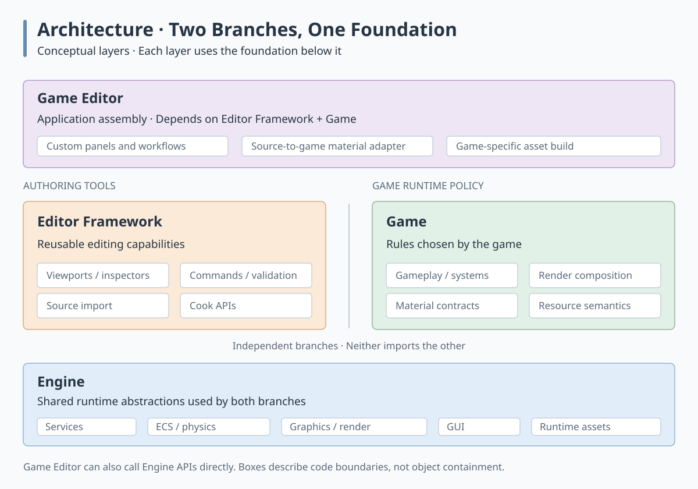
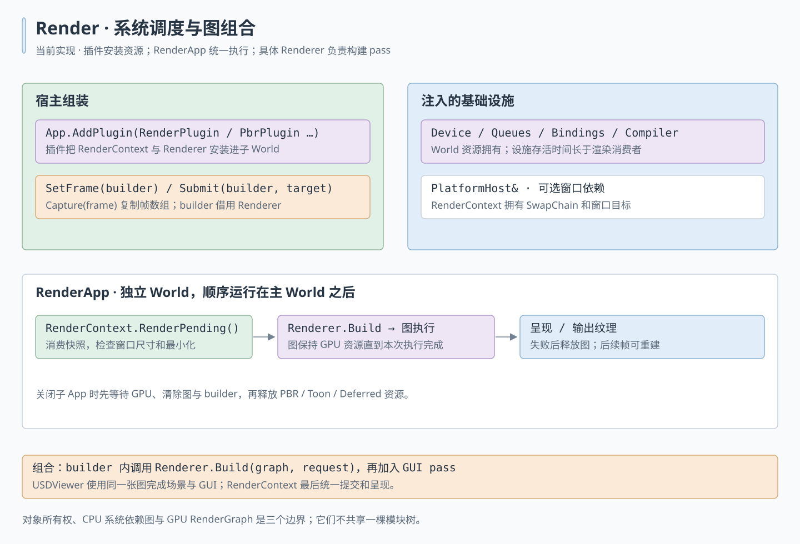

# Hitagi Engine Overall Abstraction Design

Hitagi separates reusable runtime facilities, reusable editing facilities, game runtime policy, and the application that combines them. The four roles are **Engine**, **Editor Framework**, **Game**, and **Game Editor**. The Editor Framework and game share engine abstractions and remain independent of each other; the game editor connects their capabilities for a particular game.

This separation lets a game use its own renderer, material contracts, and asset conversion rules while reusing the engine and editor framework. A runtime distribution needs engine, game, and the required cooked assets and external resource files. Authoring dependencies stay on the editor side.

## Dependency structure

The diagram arranges code responsibilities in layers. Game Editor integrates the two independent branches, Editor Framework and Game; both use Engine as their shared foundation. This is a build-dependency view, not asset data flow or runtime object ownership.



Equivalently:

```text
Engine <- Editor Framework <- Game Editor
Engine <- Game             <- Game Editor
```

The game editor can also use engine APIs directly. Engine has no dependency on editor or game, and game has no dependency on editor. Game-specific integration belongs at the top, where both sets of APIs are available.

| Role | Owns | Representative code |
| --- | --- | --- |
| engine | Runtime services, ECS, physics, graphics and rendering primitives, GUI, runtime resources and their loading contracts | [`hitagi/engine`](../../hitagi/engine/engine.cppm) and the modules it assembles |
| Editor Framework | USD import, material source metadata, material graph validation, and Cook APIs | [`hitagi/editor`](../../hitagi/editor/editor.cppm) |
| game | Gameplay, resource semantics and rendering policy | To be developed from game requirements |
| game editor | Game-specific asset conversion and tools | To be developed from game requirements |

## Current render architecture

The `render` module provides concrete PBR, Toon and deferred renderer systems.
Each exposes `ConfigureSchedule(ecs::Schedule&)` and declares Render-group work; none
inherits a runtime module base. Applications register systems in the Engine's
World with explicit constructor dependencies, or own renderer utilities while
composing their own graph. Engine creates no default renderer, owns no renderer
slot, and does not re-export `render`. See [ECS-driven runtime](runtime_schedule.md).



Editable [SVG](../assets/render_architecture.svg) and matching [PNG preview](../assets/render_architecture.png). Arrows show execution flow; containers and annotations identify ownership and injected dependencies.

The host creates Engine's infrastructure first, then injects individual services at the composition root. Renderers never receive or look up an Engine instance:

```cpp
import engine;
import render;

hitagi::Engine engine(config);
auto& renderer = engine.GetWorld().RegisterSystem<hitagi::render::pbr::PbrRenderer>(
    engine.ResourceLoadContext(), engine.App());
renderer.SetFrame(frame); // camera, draw items and lights; retained until replaced

engine.Tick(); // renderer handles its window target, graph execution and presentation
```

Constructing a renderer with `Application&` enables window rendering. The renderer owns its SwapChain and color target, skips window rendering while minimized or zero-sized, resizes the SwapChain and recreates its target when dimensions change, and presents after graph execution. `SetFrame(frame)` snapshots the scene inputs and retains them until replaced; each scheduled `RenderPending()` renders the current snapshot, which is empty by default. The application must outlive the renderer. No child adapter or callback is required.

For offscreen rendering, use the constructor without Application and call `Submit(frame, target)`. Each submission renders once on the next Render-group execution, writing the caller-owned texture. A window renderer can also consume offscreen submissions before drawing its window. `SetFrame` rejects renderers created without Application; use `Submit` or `Build` for those instances.

Both `SetFrame` and `Submit` copy views, draw items, and lights and retain shared resources. They do not deep-copy mesh/material contents; calls and resource mutation must be serialized by the host. `ConfigureSchedule` declares the task that calls `RenderPending()`, consumes offscreen submissions, then renders its window. A failed execution retires the graph before propagating the error; later executions can create a fresh graph. World releases cached tasks before destroying registered renderer state.

For custom composition, all three renderers expose `Build(graph, request)`, which only adds passes and returns graph handles. The caller then owns compilation, execution, import cleanup, and presentation. Execute that graph before the next `Build()` or `RenderPending()` on the same renderer, and keep the renderer and any borrowed resources alive until execution completes. Deferred exposes debug views and `IDeferredRenderExtension`; PBR owns the `PBRForward` material contract. Toon owns `ToonForward` and `ToonOutline`; see its [rendering and material contract](toon_renderer.md). PBR and Toon share renderer-neutral scene draw inputs; ECS remains responsible for instance animation and skinning. Custom application renderers remain ordinary system types with their own APIs.

GUI is an opt-in component: `gui::GuiRenderUtils` adds drawing passes, including PocketJS text, to the application graph. A UI host owns `GuiManager`, prepares layout before rendering native overlays, finishes GUI composition, and builds the GUI pass before executing the graph. No implicit GUI submission is performed by Engine.

## Current authoring library

The interactive editor has been removed. The retained `editor` C++ module is an asset authoring library, built as `hitagi_editor`. It has no Editor runtime module, UI bundle, viewport, command stack or Play mode.

```text
hitagi_editor -> engine + hitagi_interop_editor
asset_pipeline_tests -> hitagi_editor + test bridge
```

The engine build target contains the runtime render implementations. The Editor Framework's material graph compiler knows no shading model: it lowers a graph into a Slang material module and specializes an `asset::MaterialPassTemplate` supplied by a renderer, such as `render::pbr::PbrForwardPassTemplate()`. A future game tool can supply `UsdSceneImporter::MaterialProcessor` to convert source materials to the game's contracts, without adding game policy to the importer.

## Shared runtime objects and authoring metadata

Both branches use `asset::Scene`, `Mesh`, `Material`, `Texture`, `Camera`, and `Light`. Source import produces these resource types directly, so the editor can render and manipulate them before cooking. Runtime cooked loading reconstructs the same types. Sharing the model means sharing APIs and semantics; loading a cooked file creates new objects rather than restoring process pointers or editor object identity.

Editor-specific provenance is attached outside the runtime material:

```cpp
struct EditorMaterial {
    std::shared_ptr<asset::Material> material;
    MaterialSourceInfo source_info;
};
```

`MaterialSourceInfo` records source paths, source shader identifiers, source parameters, and unsupported inputs or nodes. `EditorCookContext` associates that information with material objects. The runtime `Material` carries parameter values and `MaterialPass` descriptions. Its resource representation does not require the source document or editable graph.

A `MaterialPass` specifies a pass contract, pipeline, ordered typed bindings with mandatory defaults, and packed material data. Cook rejects missing or mistyped final parameters. Runtime warns and uses contract defaults without changing field layout. The game renderer selects a compatible pass; the asset layer manages its representation and resource loading. This keeps a game-specific shading model out of the generic asset type. See [Materials](../assets/material.md) for the binding contract and shared storage ABI details.

## Cooking and runtime loading

The authoring and runtime sides meet at two contracts: the shared resource model in memory, and the HTGC format used to deliver cooked resources.

```text
Source assets
    -> Generic editor importer + game editor material processing
    -> asset::Scene / Material / Mesh ...
    -> Editor Cook API
    -> HTGC bytes + referenced external files
    -> AssetManager cooked loader
    -> asset::Scene / Material / Mesh ...
    -> Game renderer
```

The Editor Framework provides `CookEditorScene` and `CookEditorMaterial`, which return a `core::Buffer`. Writer and reader share the POD layout declarations in `asset:cooked_format`. The caller chooses output paths, persists the result, and arranges required external files. Texture pixels remain in referenced image files; shader descriptors can carry paths or source text. Source metadata and editable material graphs are not serialized into HTGC.

Callers assemble the required services, import source resources, invoke Cook APIs and write the returned buffer. There is currently no bundled cook executable or editable-scene save workflow. HTGC is a runtime delivery format, not a lossless authoring document format.

See [Cooked binary format](../assets/cooked_binary_format.md) for the file layout and reader/writer contract.

## Shader ABI and optional rendering policy

Engine owns bindless descriptors, handles, residency, and the raw-storage shader layout API. Each renderer owns its pass shaders: the PBR frame, instance, and draw records are mirrored by hand in `assets/shaders/pbr_forward.slang`, like the deferred shaders; reflection-based layout validation is follow-up work. Material shader fields are generated from the same typed defaults that govern runtime packing. A game chooses what a draw references, but does not manage descriptor indices.

Applications explicitly import `render` to select a built-in renderer or implement their own system. The built-ins own their frame/request/result types and rendering policy. Their source files are in `hitagi/engine/render/`, collected by the engine build target; the `engine` C++ module does not import or re-export `render`. This keeps Engine's composition class independent of specific renderer APIs without creating a circular target dependency.

The material graph compiler lives in `hitagi/editor/material_compiler.cppm` and depends only on engine; PBR lighting stays in the renderer's Slang shell. Generic USD import does not depend on PBR; game editor supplies the conversion adapter. The former material cache and hot-reload placeholder API are removed rather than presented as completed facilities.

## Service composition and resource lifetime

`Engine` assembles and owns runtime infrastructure, including file I/O, jobs, graphics services, and `AssetManager`. The host application supplies configuration, chooses game and editor modules, and installs a renderer. Configuration persistence belongs to the host. A headless tool or test can assemble just the services it needs, as the asset pipeline tests do.

Consumers receive explicit dependencies. For example, `AssetManager` receives `FileIOManager` and `JobSystem`; resource GPU loading receives a `ResourceLoadContext` containing device, queues, bindings, and shader compiler. The game editor uses the engine instance it owns to connect these services to editor and game code. See [Dependency injection](dependency_injection.md) for injection forms and destruction order.

The asset manager provides lookup, texture deduplication, and loading policy through weak-reference registries. Actual resource ownership follows `shared_ptr` relationships, such as Scene components holding Mesh objects and SubMesh objects holding Materials. GPU residency is controlled by `Resource::Load` and `Unload`, independently of whether the consumer is an editor preview or a running game. See [Resource lifecycle](../assets/resource_lifecycle.md) for asynchronous texture decode and unload coordination.

## Placing new functionality

Use the information a feature must understand to decide its home:

| A feature needs to understand | Place it in |
| --- | --- |
| Generic runtime resources, graphics operations, ECS, or scheduling | engine |
| Generic authoring operations, source import, editor interaction, or cooking mechanics | Editor Framework |
| A game's runtime behavior, shading semantics, or render-pass policy | game |
| Both editor APIs and game-specific rules, including source conversion and custom inspectors | game editor |

Keep editor-only dependencies out of runtime targets. Add a narrow extension point to a reusable layer when its caller must supply game policy, as with `MaterialProcessor`; let game editor provide the implementation. Reuse the shared resource model where its semantics fit, and retain authoring-only state at the editor boundary.
