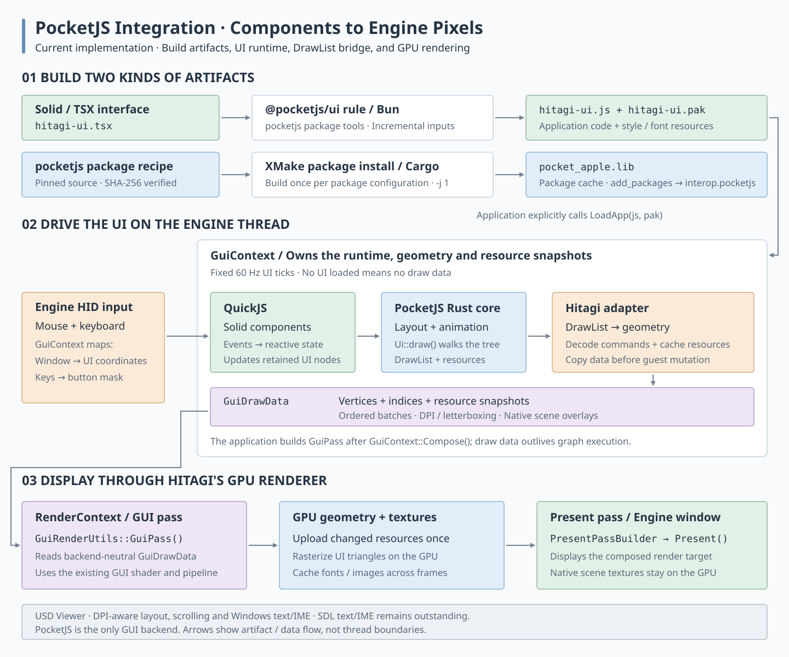

# PocketJS integration

PocketJS is the only GUI backend. The integration runs Solid/TSX components in QuickJS. The Rust core computes layout and animation and produces a DrawList; Hitagi converts it into indexed geometry and renders it through its Vulkan/DX12 GUI pass. The production path does not allocate a full-window CPU framebuffer. The upstream software renderer remains available to the native smoke test as a reference.



[PNG preview](../assets/pocketjs_integration.png). The arrows describe artifact and data flow; the runtime boxes are responsibilities, not separate threads.

## 1. Build and explicitly load the UI

[One local XMake package](../../xmake/packages/p/pocketjs/xmake.lua), `pocketjs 0.14.0`, uses the version declared in upstream's `package.json`, pins upstream commit `55e39a06868c9776f0320909ba37b187f0606d0f` and verifies its source archive checksum. Hitagi-specific adaptations live in the package recipe and supporting files; they do not introduce a separate PocketJS version. It provides the native runtime, TSX tools and exported UI rule while keeping package installation separate from application resource compilation:

- [pocketjs](../../xmake/packages/p/pocketjs/xmake.lua) calls Cargo to build the portable `pocket-apple` static library, containing QuickJS, the Rust runtime and Hitagi's DrawList/resource bridge. It installs headers and the library into XMake's package cache and declares the Windows system libraries. The historical name does not imply a UIKit dependency. `hitagi_interop` consumes it through `add_packages`; [interop.pocketjs](../../hitagi/interop/pocketjs.cppm) preserves the C ABI module bridge.
- The same package installs the compiler/framework and locked Bun dependencies under `share/pocketjs`. Installation does not build any Hitagi application. The recipe currently supports native Windows x64 builds; Cargo and Bun must be on `PATH`. Cross-compilation is not implemented.
- The package installs `pocket.h`, containing the C ABI and a handwritten C++ adapter for the pinned SDK's `contracts/spec/spec.ts`. It owns draw enums, command lengths and resource-format helpers; `interop.pocketjs` re-exports them for the draw decoder. Review these definitions against the upstream contract when upgrading PocketJS. Existing package caches need reinstallation when the adapter changes.
- The exported [@pocketjs/ui rule](../../xmake/packages/p/pocketjs/rules/ui.lua) invokes Bun on an application's TSX entry, such as [hitagi-ui.tsx](../../hitagi/editor/ui/hitagi-ui.tsx). UI targets use `add_packages("pocketjs")`, `add_rules("@pocketjs/ui")` and the `pocketjs.entry` / `pocketjs.density` values. Output remains `build/pocketjs/ui/hitagi-ui.js` plus `hitagi-ui.pak`. Applications and tests explicitly depend on the bundles they use.

The [root TypeScript config](../../tsconfig.json) covers TS/TSX sources under `examples/` and `hitagi/`. During `xmake f`, the UI rule's `on_config` hook generates `build/pocketjs/tsconfig.json` from the resolved SDK location, without building native code or UI bundles. Lua writes the JSON and uses the SDK's TypeScript parser through Bun to preserve aliases from its commented config, then adds Solid and host-bridge mappings. Unchanged output retains its timestamp. Run `xmake f` after installing dependencies or removing `build/`; machine-specific paths remain outside Git. Existing package installations retain a copy of the exported rule, which must be refreshed or reinstalled when the rule changes.

The editor framework owns `pocketjs-editor-ui` in `hitagi/editor/xmake.lua`; applications inherit that dependency through `hitagi_editor`. GUI tests do not build TSX fixture bundles. Text input components and their TypeScript unit tests belong to the editor.

The UI rule records the compiler's input manifest, including imported UI modules, fonts and resource manifests, and tracks its own script as a build input. Unchanged inputs skip bundling; missing outputs force regeneration. UI edits do not rebuild the native dependency. Compiler patches redirect the generated style mirror and transform cache to each target's `build/pocketjs/work/` directory. The installed framework has a placeholder style module for Bun's first-pass resolver; actual styles are injected into each bundle in memory. UI builds do not mutate the shared package installation or depend on `.local/pocketjs`.

The root `tsconfig.json` extends the generated SDK configuration; run `xmake f` to prepare editor type checking without building application C++. A first package installation also builds the native Rust library.

The [editor entry point](../../examples/editor/main.cpp) constructs the engine; the Editor module calls `GuiManager::LoadApp(js, pak, {.desktop = true, .raster_density = 2})`. Its UI targets build resources with the matching `--density=2`; game/fixture targets retain density 1. Construction alone does not load a UI. Loading uses a candidate runtime: a failed load preserves the previous working application, while successful loading keeps initial layout effects from the new guest.

## 2. Advance the runtime and collect drawing commands

[GuiManager](../../hitagi/gui/gui_manager.cpp) owns a native runtime created with `pocket_create_gpu`. This constructs the same upstream `Guest` and `UiSurface` as the portable host, without allocating its software framebuffer. Existing load, event and frame APIs remain in use; production code never calls `pocket_apple_render`.

All calls run on the engine thread. The adapter accumulates elapsed time and advances the guest/core at fixed 60 Hz steps, clamping each elapsed-time contribution to 0.1 seconds. Desktop input uses floating-point pointer packets in logical coordinates, wheel messages and keyboard navigation. Fixed-canvas mode retains letterboxing and encoded touch input.

The package-owned [C ABI extension](../../xmake/packages/p/pocketjs/pocket.h) exposes:

- `pocket_draw`: runs `Ui::draw()` and returns the packed DrawList, plus resource slot counts. Drawing can allocate core glyph/disc pages, so resource enumeration follows this call.
- `pocket_texture`: returns a live texture's generation-tagged handle, content revision, format, pixels and sampling mode.
- `pocket_font`: returns an atlas's revision, coverage bytes and logical/coverage cell dimensions.

These are borrowed views, consumed synchronously before subsequent guest mutations. [PocketDrawDecoder](../../hitagi/gui/draw.cpp) copies the command words, decodes them into engine-owned geometry, and caches immutable RGBA8 resource snapshots. Texture identity/revision and font revision determine replacement; unchanged resources share the same snapshot. Each replacement receives a unique engine resource ID, including across UI reloads. Freed core textures leave the current resource set, while older copied frame data retains its shared resources.

The decoder handles rectangles, gradients, glyph runs, textured quads, triangles, textured triangles and nested scissors. It expands 5650, 4444, 8888 and indexed T8 textures once per resource change. Glyph atlases retain bundle density and include transparent gutters for fractional-DPI filtering. Native-provider text and Pocket System compositor surfaces are rejected explicitly: this host installs neither provider. Editor scene/image previews continue through `DrawTexture`.

`pocket_resize` updates the existing guest and core viewport without reloading components. GPU hosts change layout dimensions without allocating a pixel buffer; the software reference host still resizes its framebuffer. The desktop layout uses window dimensions divided by the OS DPI ratio. Resource density and display scale remain separate: editor bundles bake density-2 glyphs, and the GPU draws their quads in physical window coordinates.

## 3. Render with Hitagi's GPU pipeline

`GuiManager::Tick()` transforms logical geometry and clip rectangles into display coordinates, then appends frame-local scene/preview texture quads. `GuiDrawData` owns geometry and shared immutable image/font snapshots; it no longer uses a full-screen image in a `font_atlas` field.

[GuiRenderUtils::GuiPass()](../../hitagi/render/render_utils.cpp) caches GPU textures by immutable resource ID. It uploads a resource only when first encountered, drops cache entries absent from the current resource set, and declares all texture accesses through RenderGraph. The graph retains imported resources through execution. After GPU completion, `RenderRuntime` clears frame imports so replaced textures can be released; live renderer caches reimport their resources next frame. Fonts use linear filtering; images preserve the core's sampling hint. Solid geometry outputs vertex color directly. The current UNORM target preserves the portable renderer's encoded-byte color blending convention.

Each frame uploads vertex/index and draw-parameter buffers. Consecutive geometry with the same resource and clip rectangle is batched without reordering transparent draws. Hitagi rasterizes those triangles directly into the render target, composites native GPU scene textures and presents the result. There is no UI-wide BGRA-to-RGBA conversion or framebuffer upload. Layout, animation, tree traversal and geometry conversion still consume CPU time; this change does not imply a measured frame-rate improvement.

The application schedules `RenderGui()` with a draw-data reference, which `RenderRuntime` consumes after the GUI tick. Window resize and native viewport ordering remain as described below.

## 4. Frontend-style editor presentation

The [shared shell](../../hitagi/editor/ui/editor-shell.tsx) uses Solid components and [theme tokens](../../hitagi/editor/ui/theme.ts) for colors, spacing and typography. A restrained violet accent distinguishes selection/primary actions; disabled buttons are dimmed instead of receiving a textual prefix. The shell owns draggable hierarchy/inspector widths and asset-panel height. Hierarchy branches collapse; hierarchy, folder navigation, asset rows and inspector content accept wheel scrolling. Assets filter by top-level folder and type. Short windows clip and scroll the inspector instead of drawing over other panels.

Resize ordering matters: Editor calls `GuiManager::PrepareFrame()` before draining layout commands and rendering native overlays. The later GUI tick composites those textures without advancing the already prepared UI again. Desktop logical coordinates map through one uniform DPI scale, including the interval before re-layout. The scene camera uses the displayed rectangle aspect ratio, not the block-rounded/downsampled render-target ratio.

Windows enters a [modal move/resize loop](https://learn.microsoft.com/en-us/windows/win32/winmsg/wm-entersizemove) while dragging window borders. `Win32Application` installs a 16 ms timer during that loop; an explicit application callback advances the engine frame without recursively polling messages. Both callback and engine frame execution guard against re-entry, and exceptions are captured before returning from the native window procedure. DX12 uses [DXGI_SCALING_NONE](https://learn.microsoft.com/en-us/windows/win32/api/dxgi1_2/ne-dxgi1_2-dxgi_scaling) so an old back buffer is not stretched between resize and the next present. This does not add a render thread.

Native scene state, undo/redo and commands remain authoritative. The UI sends `layout` commands containing logical scene and image-preview rectangles. `SceneViewPort` and `ImageViewer` consume those rectangles, and `DisplayRect` supplies the matching physical placement/picking transform. They no longer duplicate fixed panel coordinates. A game-preview host uses the central rectangle for its native game texture instead.

## 5. Game preview extension

The Editor-owned `IEditorGamePreview` contract lets game-editor hosts supply a native game texture, lifecycle controls and state publication. Game logic remains outside the generic Editor. The former Snake example and its UI bundles have been removed; the extension contract remains available for game integrations.

## Scope and validation

The paragraphs describing earlier package/desktop validation below are historical. GPU-path validation is recorded separately at the end of this document.

The unified package at the pinned upstream commit was installed and checked on Windows/clang-cl using one-core affinity, below-normal priority and `-j 1`. An isolated consumer built the exported rule's editor/input bundles and the C++ module bridge, then passed the native smoke checks. Incremental checks covered unchanged outputs, imported TS edits and missing PAK regeneration; the latter preserved sizes and modification times of all 10,757 installed package files. References to the removed Snake targets and smoke fixtures have since been cleaned up.

RenderRuntime reconciles actual swapchain/window sizes even if event polling has already cleared the resize flag. Editor resize regressions cover native modal frames on both DX12 and Vulkan. No manual interactive playthrough, full clang-tidy scan or mixed-DPI validation is claimed. Existing DX12 screenshot readback limitations below remain.

The editor uses a native service queue for C++ state snapshots and UI commands. C++ retains scene ownership, undo/redo, Play isolation, import and cook. Current panels provide transform step controls and component creation, but numeric fields are not yet text inputs. Windows single-line text/IME is now connected through the entity-name field (see below). Docking, drag gizmos and full material/camera/light inspectors remain unported. Panel sizes are session-local, not persisted. Scene export was already unsupported.

The native recipe uses Cargo `-j 1`. XMake's `-j 1` limits engine build concurrency, but does not itself set CPU affinity or process priority. When resource usage matters, also launch configuration/build processes at below-normal priority with restricted affinity. Avoid changing the active build configuration just to run a documentation check.

```powershell
xmake build -j 1 editor
xmake build -j 1 unit_tests
xmake r unit_tests --gtest_filter="PocketGuiManagerTest.*" --jobs=1
xmake r editor --headless --gfx-backend Vulkan --frames 3 --screenshot temp/pocketjs/gpu.png
```

The temporary native smoke executable has been removed. Smoke results below are historical validation records; use the adapter tests and editor screenshot command for current checks. Adapter tests cover explicit loading, RGBA output, letterboxing, idle reuse, reload behavior, and transformed pointer input. The short screenshot run checks the actual GPU presentation path. Windows validation: the PocketJS native smoke, 39 editor tests and 5 adapter tests pass. Vulkan headless rendering and screenshots pass; DX12 headless rendering passes without capture. DX12 screenshot readback currently triggers a copy-queue resource barrier error and is not validated. No other-platform coverage is claimed.

The XMake package migration additionally verified fresh package installation, all four UI bundles, unchanged-build reuse, selective rebuilding of both shared editor-shell consumers, missing-PAK recovery, and unchanged shared SDK/native-library metadata across UI rebuilds. Editor and unit-test targets were rebuilt with clang-cl; the native smoke, five adapter tests, TypeScript check, interop audit and Vulkan screenshot were rerun. The complete editor/unit suites and DX12 were not rerun for this build-system change.

The desktop UI revision was validated on Windows/clang-cl with single-core affinity, below-normal process priority and XMake `-j 1`: editor, smoke, editor-test and unit-test builds; all 39 editor tests; all 6 GUI adapter tests; TypeScript checking; and an interop audit with zero violations. Native smoke now checks density-2 dimensions, invalid/successful resize, state preservation, mouse coordinates above 1023, splitter dragging, hierarchy collapse and wheel scrolling, asset scrolling, and reaching component controls in a 960×540 window. Adapter coverage also checks initial layout effects and cancellation after input reset. The actual Vulkan editor screenshot is saved to `temp/pocketjs/editor-desktop.png`; native snapshots cover 1200×800 and 960×540 logical layouts. The complete engine unit suite, DX12 and mixed-DPI monitor transitions were not rerun for this revision; no full clang-tidy scan is claimed.

The live-resize fix passes 41 editor tests and 11 selected GUI/application tests. New coverage checks uniform coordinate scaling before re-layout, preparing layout only once per frame, callback re-entry/exception handling, and real Vulkan/DX12 rendering across wide/tall window changes driven only by synthesized Win32 sizing/timer messages. These are hidden-window integration tests, not a manual mouse-drag inspection. The Vulkan editor five-frame screenshot (`temp/pocketjs/editor-resize-fixed.png`) also passes. The interop audit reports zero violations; the complete engine suite, mixed-DPI transitions and full clang-tidy scan were not run. Validation retains single-core affinity, below-normal priority and `-j 1`. An old editor entry-point object survived the initial incremental build after the Engine layout change; rebuilding that application with `xmake build -r --shallow -j 1 editor` resolved the startup mismatch.


## GPU DrawList migration validation

The final Windows/clang-cl run passed all 9 focused GUI/GPU tests, all 42 editor tests (including Vulkan and DX12 modal-resize rendering), and the native smoke test. The editor, unit-test, editor-test and smoke targets built successfully.

Windows/clang-cl builds cover the editor, native smoke, unit-test and editor-test targets. Focused checks cover explicit loading, letterboxing, pointer/keyboard interaction, DPI/resize ordering, all four image formats, freed/reused texture handles, immutable old-frame ownership and resource reuse. A Vulkan readback regression checks solid color, textured alpha blending, clipping and replacement across frames. The native smoke compares DrawList words between software and GPU hosts under the same fixture inputs, and verifies that a large GPU viewport can be created/resized without a full-screen pixel allocation.

The editor's Vulkan screenshot is visually checked for background fills, rounded corners, text and native scene composition. Shader changes use the workspace's existing Slang pipeline. This migration does not claim an FPS speedup, a complete engine test-suite run or manual interactive coverage. The validation logs and screenshot are under `temp/pocketjs-gpu/`.


## Windows text input and composition

The Windows host consumes `WM_IME_STARTCOMPOSITION`, `WM_IME_COMPOSITION` and `WM_IME_ENDCOMPOSITION` while a text field owns input. `GCS_RESULTSTR` produces a commit; `GCS_COMPSTR`, cursor, attributes and clause data produce a preedit update. The host consumes these messages without default result emission, suppresses the default composition window, and leaves the candidate window to Windows. Ordinary `WM_CHAR` input combines UTF-16 surrogate pairs; control characters are handled as editing keys. Composition-owned keys remain consumed until release.

`InputManager::DrainTextInput()` transfers an ordered queue of start/update/commit/end/key/blur events once. Each carries its focus-session id; text and offsets use UTF-16 to match Windows and JavaScript. `GuiManager` sends them through the existing overlay state channel as `kind: "text"`, forces a GUI step when input is pending, and consumes the private `hitagi.text <session> <x> <y> <width> <height> <caret-x> <caret-y>` effect before application effects reach Editor. All geometry is logical UI geometry; `DisplayRect()` converts the caret for the native candidate window. Zero session ends input. Session changes cancel native composition. Focus loss, disposal and successful bundle reload release ownership; delayed events cannot modify a different field. Keyboard navigation and editor shortcuts are suppressed during editing, including the frame that ends editing and held confirmation buttons until release.

The reusable implementation is in `hitagi/editor/ui/text-edit.ts` and `text-field.tsx`. The single-line field supports selection with Shift/arrows and Ctrl+A, Home/End, deletion, local Ctrl+Z/Y, inline preedit with target-attribute underlines, and horizontal scrolling. Activating a field selects its contents. Enter/Tab or clicking outside accepts the committed draft; Escape cancels the field edit. Ending composition alone never inserts text. Clicking away discards unfinished preedit before accepting the committed draft. The editor binds the field to `RenameEntityCommand` with the original entity id, preserving scene undo/redo. Numeric fields still use step controls.

`hitagi/editor/ui/fonts.json` explicitly bakes CJK Unified Ideographs (U+4E00�C9FFF), Japanese kana/punctuation and fullwidth forms using the checked-in Noto fonts. This increases the density-2 editor PAK to about 110 MB; font GPU atlases use more columns for large coverage. This is bounded baked coverage, not a runtime font provider: supplementary ideographs, emoji rendering, complex-script shaping, grapheme-cluster editing, clipboard actions and pointer-based caret placement are not implemented by this change. UTF-16 supplementary characters are preserved by the input/edit pipeline even when their glyph is unavailable. The native IME path is Windows-specific; SDL text/IME integration is still outstanding.

Focused checks: `bun test hitagi/editor/test/text-edit.test.ts`, TypeScript checking with the root `tsconfig.json`, and `xmake r unit_tests --gtest_filter="PocketGuiManagerTest.*:PocketGpuRenderTest.*:AppTest.*"`. Synthetic message/queue checks do not replace an interactive test with installed Chinese/Japanese IMEs and mixed-DPI monitors.

Windows/clang-cl validation for this change: editor, unit-test, editor-test and native-smoke builds pass; all 8 text-model tests, 16 selected GUI/IME/platform tests, all 42 editor tests, TypeScript checking and the interop audit (0 violations) pass. The actual editor smoke checks preedit does not rename an entity and accepting the field emits exactly one rename command. Its composition snapshot is visually checked, and a three-frame Vulkan editor screenshot passes. Logs and images are under `temp/ime/`. An incremental build retained stale Application consumers after the virtual-interface change; rebuilding application/test consumers with `-r --shallow` resolved the ABI mismatch. No live OS candidate-window interaction, mixed-DPI IME run, full engine suite or clang-tidy scan is claimed.
