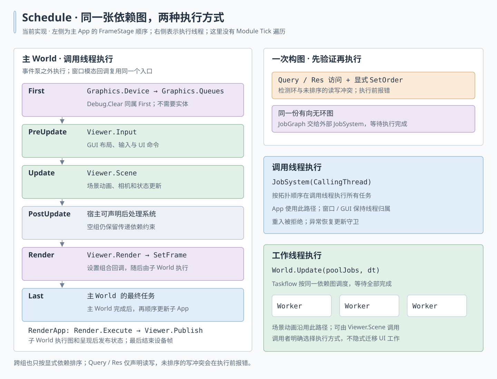

# ECS-driven runtime

Engine owns infrastructure; ECS systems declare work; Schedule orders and executes
that work. There is no RuntimeModule base, child-module tree, or GraphicsServices
owner. C++ modules remain source-code boundaries and are unrelated to this runtime
execution model.

## Ownership and assembly


MemoryManager, FileIOManager, JobSystem, Application, Device, CommandQueues,
bindings, ShaderCompiler, AssetManager and PhysicsWorld have explicit lifetimes.
Engine constructs them in dependency order and releases them in reverse. Assets
and Physics have no implicit per-frame work: the former never overrode Tick and
the latter's Tick only visited children. Physics still advances through explicit
Step calls from its consumers.

`Engine::GetWorld()` exposes the runtime ECS World for registration. A system is
an ordinary type with optional lifecycle hooks and `ConfigureSchedule(Schedule&)`; no
inheritance is required. Constructor arguments inject its dependencies. World
owns its instance, and repeated registration of the same type returns the same
instance and enables it without reconstructing it. One instance per type is
supported; application-owned collections model multiple views or windows.

```cpp
import engine;
import ecs;
import render;

hitagi::Engine engine(config);
auto& renderer = engine.GetWorld().RegisterSystem<hitagi::render::pbr::PbrRenderer>(
    engine.ResourceLoadContext(), engine.App());
renderer.SetFrame(frame);
engine.Tick();
```

Renderer references returned by registration are borrowed. Remove consumers
before unregistering a provider whose state they borrow. Services passed into a
system must outlive every schedule snapshot using it. There is no global service
lookup and no dummy entity containing infrastructure pointers.

## Work and execution



`ConfigureSchedule` declares tasks when the schedule is built, not on every frame.
Registry changes invalidate the cached schedule for the next update. Configuration
only declares work; frame-dependent data is read inside the task callbacks. A
zero-argument Request runs once per update even if the World has no entities;
Query callbacks also run once, and explicitly invoke Each or ParallelEach.

Group labels are enum values supplied by the host. ECS stores their exact enum
identity (`std::type_index`) and underlying value; different enum types never
become equal just because their integer values or hashes match. Aliases with the
same value in one enum intentionally identify the same group. Numeric enum order
has no scheduling meaning. Tasks without a group have no implicit frame phase.

The `engine` module defines `FrameStage` and the free configuration function
`ConfigureFrameStages`. Engine constructs its World with this function, which
declares First -> PreUpdate -> Update -> PostUpdate -> Render -> Last through
`SetOrder(group, group)`. There is no policy-only system. The `app` module handles
platform events and windows; it owns no frame stages. ECS only knows generic group
labels. Standalone hosts can reuse the engine policy or supply their own enums.

```cpp
// Engine-owned frame policy, reapplied whenever the schedule is rebuilt.
ecs::World world("Runtime", ConfigureFrameStages);
world.RegisterSystem<gfx::GraphicsFrameSystem>(device, queues, FrameStage::First);
world.RegisterSystem<debugger::DebugManager>(FrameStage::First);
```

`World(name, configure_schedule)` retains an optional configuration callback.
On each schedule rebuild it calls this callback before configuring registered
systems. The unchanged schedule is cached. If configuration throws, the candidate
is discarded and the next Update retries; no candidate tasks have run. Callback
captures must outlive the World. Changing external configuration does not itself
invalidate a cached schedule: this hook is for stable composition policy.

All tasks in the first group finish before any task in the next group starts.
Empty groups preserve transitive constraints and participate in cycle validation.
A task currently belongs to at most one group. Group entry/exit nodes represent
barriers in the same graph as task dependencies, avoiding all-to-all task edges.

Query describes component reads/writes without choosing their temporal order.
Task/group SetOrder edges define execution order. Unordered read/write or
write/write pairs are diagnosed before execution; read/read pairs can run
concurrently. Cross-group conflicts follow the same rule. Cycles, duplicate task
names and missing order endpoints also fail during graph preparation. See
[Query and explicit order](ecs.md#query-and-explicit-order).

```cpp
struct MySystem {
    Simulation& simulation;
    Renderer& renderer;

    void ConfigureSchedule(hitagi::ecs::Schedule& schedule) {
        schedule.Request("Game.Simulate", [this, &schedule] {
            simulation.Update(schedule.GetDeltaSeconds());
        }, hitagi::FrameStage::Update);
        schedule.Request("Game.Render", [this] {
            renderer.Draw(simulation);
        }, hitagi::FrameStage::Render);
    }
};
```

This example uses application-defined Simulation and Renderer types and assumes
the host constructed its World with `ConfigureFrameStages` (Engine does this). Captured
services are not inferred as ECS component accesses: express their ordering
explicitly. Independent tasks in one group have no promised relative order.

`World::Update(job_system, delta_seconds)` is the only update entry. Schedule
passes its validated core JobGraph to the supplied JobSystem and waits for
completion. Engine owns a CallingThread JobSystem for the frame World and a
separate thread-pool JobSystem for CPU services and scene updates. A one-worker
pool is still a worker thread, not a main-thread executor. No implicit
worker-to-main-thread migration is implemented. JobSystem also executes nested
Query batches, with cooperative waiting on its own workers.

`gfx::GraphicsFrameSystem` is exported directly by `gfx`. It borrows Device and
CommandQueues, accepts an `ecs::Group` from its host, and declares Device.BeginFrame
before Queues.NewFrame within that group. Engine places it and DebugManager in
First. Neither module imports engine or names FrameStage. USDViewer declares Input in
PreUpdate, Scene in Update, Render in Render, and Publish in Last. Its renderer
objects are private graph-building utilities, not nested tickable modules.
Standalone PBR/Toon/Deferred systems register a task consuming queued snapshots
and presenting window frames. Their constructors and GuiManager's constructor
accept an optional `ecs::Group` as their last argument. A host using the engine
convention explicitly supplies `FrameStage::Render`; omitting the group means
ungrouped work, not an implicit render stage. Direct Build/Compose usage needs no
stage. This keeps reusable rendering/GUI modules independent of engine policy.

## Event loop and shutdown

Engine::Tick polls native events through Application::PollEvents, then runs the
frame World. A Windows modal resize callback runs the frame World directly,
without re-entering the native event pump. Frame guards reset on exceptions.
Clock advancement stays at frame end, preserving the previous delta-time contract.
This change does not alter event-loop pacing or introduce reactive rendering.

Engine clears the modal callback, waits for submitted CPU work and then GPU work,
and destroys its World before its service members. System destructors must release
state rather than launch new asynchronous work. External producers and resources
remain their owner's responsibility. The queue barrier uses the existing gfx
error policy; this refactor does not introduce device-loss recovery.

World releases its cached schedule and shuts down systems in reverse registration
order while entity storage still exists. Bound system instances are retained by
each cached schedule, so unregistering during execution cannot destroy the
object used by later tasks in that snapshot. Lifecycle callbacks still run
immediately, as in the existing ECS contract; they must not invalidate data used
by active tasks. Registry mutation and world updates are not concurrently safe.

PhysicsWorld separately drains its own submitted Jolt jobs before destroying its
simulation and job adapter. A Jolt simulation barrier can complete before the
executor releases its final Job reference; waiting only on the simulation barrier
does not protect adapter lifetime. This local drain does not wait for unrelated
JobSystem work.

## Verification entry points

- `RuntimeScheduleTest`: zero-entity tasks, caller-thread execution, group/order
  validation, cached state, unregister during execution, frame duration, and
  registration failure.
- `EcsTest`: existing component queries, mutation and serial/parallel contracts.
- `RendererSystemTest`, built-in renderer tests and `WindowRendererTest`: scene
  ordering, lifetime, GPU snapshots, minimized windows and modal resize frames.
- `usd-viewer-e2e`: the actual viewer systems run through a World for both replay
  and interactive execution; state and PNG output are compared across replay.
