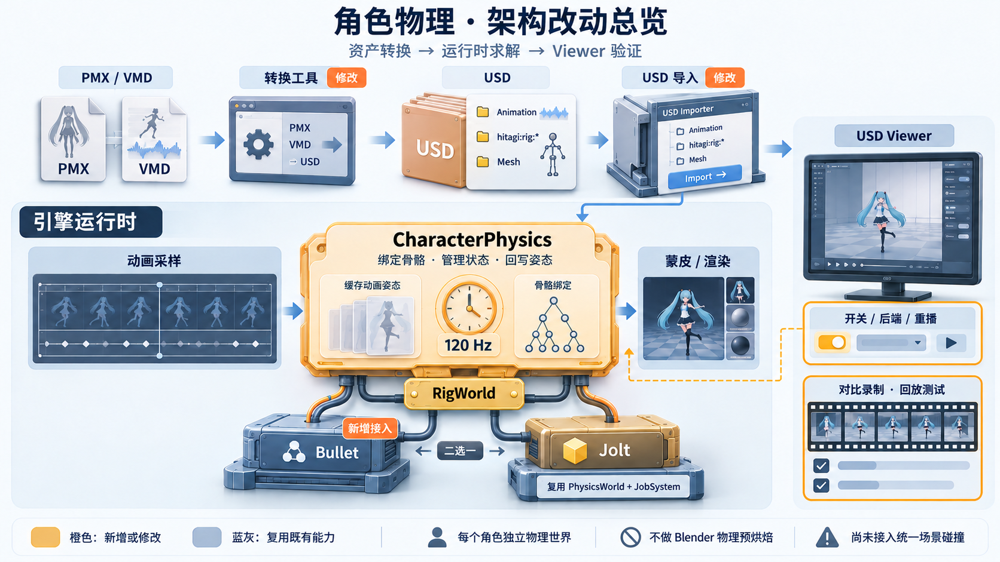

# Runtime authored character physics

`physics::CharacterPhysics` imports an authored rigid-body character rig and
solves it with Bullet 3.25 or Jolt 5.6 during Viewer playback. The Viewer exposes
a Bullet/Jolt switch beside Physics On/Off. Bullet remains the default. It restores the sampled pose,
evaluates UsdSkel animation, advances dynamics, writes bone transforms, then
runs transform propagation and skinning. The current Miku asset contains
173 bodies and 229 six-degree-of-freedom spring constraints.

The previous independent-tail solver failed visual review. See
[research and implementation rationale](secondary_motion_research.md) for the
primary sources, the coordinate conversion bug, and the distinction between
this asset-compatible model and continuum cloth / strand hair.



This generated illustration is a conceptual architecture overview, not a Viewer
screenshot or a literal USD hierarchy. The source prompt is saved alongside it in
`runtime_physics_architecture.prompt.txt`.

The component and system live in hitagi/engine/physics/character.cpp.
The USD importer registers CharacterPhysicsSystem on scenes containing a rig;
Scene itself only registers its asset systems. A host constructing rigs manually
must call world.RegisterSystem<physics::CharacterPhysicsSystem>().
This keeps the module dependency one-way: physics imports asset, not vice versa.

## Architecture changes

- **Asset boundary:** the converter carries authored PMX body/joint descriptors
  alongside VMD-derived skeletal animation in USD. The USD importer validates
  this data and binds it to each character's skeleton entities.
- **Character integration:** `physics::CharacterPhysics` owns bindings, animation
  input history, fixed-step timing and the selected rig world. Its system restores
  the animation input, lets animation sampling run, then solves and writes bones
  before transform propagation and skinning.
- **Solver boundary:** `physics::RigWorld` exposes reset, step and pose access.
  Bullet and Jolt are alternative implementations; only the selected backend is
  instantiated. The Jolt implementation reuses the existing `PhysicsWorld` and
  job adapter. Asset binding logic stays out of backend code.
- **Viewer and evidence:** the existing Viewer/rendering path gains physics
  controls, backend selection, restart behavior and comparison/replay coverage.
  Its graphics in this illustration represent responsibilities, not the actual UI.

Each character has an independent simulation world. This is an authored rigid-body
rig for secondary motion, not triangle cloth simulation or shared scene physics.
The earlier independent-tail spring prototype has been removed.

## Source conversion

```powershell
node examples/usd-viewer/tools/export-miku-runtime.mjs
xmake build usd-viewer
xmake r usd-viewer temp/runtime-physics/usd/miku_bullet_physics.usda --renderer=toon --backend=DX12
```

The local inputs are Sour Miku Black v1.02, WAVEFILE VMD and three.js r160 in
`temp/miku-recording/node_modules`. These assets are not redistributed.
The converter evaluates animation, IK and grants with `physics:false`,
restores dynamic bones to rest pose, and exports only animation and physical
configuration. No Blender or Ammo simulation is run by this converter.

MMDLoader mutates rigid-body positions into bone-local offsets. The converter
uses those effective descriptors once and checks every reconstructed bind
position against the original PMX world-space position. It also preserves
MMDLoader's type-2 correction. Shapes, masses, collision groups/masks,
friction, restitution, damping, six limits and six spring coefficients come
from the asset.

## Solver and ownership

Each imported character owns one selected physics world. Bullet owns its shapes,
motion states, bodies and constraints. Jolt reuses the engine PhysicsWorld and
job adapter, with one worker plus the caller. Objects are removed before destruction.
Mode 0 follows animation; mode 1 writes position and rotation; mode 2 writes
rotation and realigns the body centre with its animated bone.

The owner and joints are Scene entities with Transform/RelationShip. Skeleton
topology is fixed for the component lifetime. Parameter/backend changes set
`reset`, which rebuilds both binding caches and the solver; topology changes
require replacing the component. Joint indices are checked when binding, not
on every animation frame.

Simulation operates in the PMX skeleton's source units, with gravity
`(0,-98,0)` and the existing 0.1 scene scale. It uses fixed 120 Hz substeps,
20 solver iterations and stop ERP 0.475 (the MMD reference convention).
Kinematic inputs are interpolated within a frame. Runtime initialization
settles one second at the current pose; this is not an offline bake.
Pause keeps the solver still. Restart/seek recreates the world, including
contact caches; unusually large frame gaps reset rather than accumulate
unbounded work. Sampling rates can still affect interpolated motion/contact.

## USD configuration

Custom `hitagi:rig:*` properties on `Skeleton` are Hitagi conventions, not a
standard USD cloth schema. Skeleton indices refer to its joint order.

| Property | Content |
|---|---|
| `bodies` | int records: joint index, mode, shape, collision group bit, mask |
| `properties` | float records: size XYZ, mass, linear/angular damping, friction, restitution |
| `bind`, `offsets` | body bind and bone-to-body matrices |
| `joints` | pairs of rigid-body indices |
| `frames` | constraint world bind matrices |
| `limits` | records: linear min/max, angular min/max, linear/angular spring XYZ |

Sphere size X is radius; box size is half extents; capsule X is radius and Y
is cylinder height. The importer validates array sizes and indices. The discarded
`hitagi:spring:*` prototype is explicitly rejected; re-export with the current
converter. HTGC cooking rejects CharacterPhysics until its format supports it.

## Jolt parameter mapping

| Parameter | Bullet baseline | Jolt |
|---|---|---|
| Geometry / mass | Authored primitives | Same dimensions and mass; each library computes inertia |
| Angular limits | Generic6Dof Euler | Twist X / pyramid swing YZ, bounds **[-max,-min]** |
| Equilibrium spring | Legacy Generic6DofSpring | Position motor, same stiffness, viscous damping 0 |
| Body damping | Velocity factor (1-d)^dt | c=(1-(1-d)^dt)/dt for factor 1-c*dt |
| Contact material | Product combination | Explicit product friction/restitution callback |
| Iterations | 20 sequential impulse | 20 velocity / 2 position steps |
| Position correction | Stop ERP 0.475 | Baumgarte 0.2; penetration slop 0.02 rig units |

Bullet's legacy angle extraction and Jolt have opposite signs for pure relative
rotations; swapping and negating angular bounds preserves asymmetric limits.
Translation bounds retain their signs. The three-axis regression verifies this
without requiring third-party assets. Compound Euler and swing/twist rotations
still differ. Fixed axes map to zero locks, reversed bounds to free axes;
nonzero locked axes are rejected. PMX provides no independent SI joint viscous
damping coefficient; Bullet's legacy spring damping is not that coefficient.
This mapping is not a calibrated continuum cloth material model.

## Build, verification and comparison

Use an isolated Release configuration to preserve the normal project settings:

```powershell
$env:XMAKE_CONFIGDIR = "$PWD/temp/runtime-physics/release-config"
xmake f -m release --toolchain=clang-cl --ispc=n --profile=n --benchmarks=n -o temp/runtime-physics/release-build -y
xmake build usd-viewer usd-viewer-e2e asset_pipeline_tests unit_tests
xmake r unit_tests --gtest_filter=RigWorldTest.*:PhysicsWorldTest.*
xmake r asset_pipeline_tests --gtest_filter=UsdRigImportTest.*:UsdSkelImportTest.*:CharacterPhysicsAssetTest.*
xmake r usd-viewer-e2e DX12 --verify-physics temp/runtime-physics/usd/miku_bullet_physics.usda jolt
xmake r usd-viewer-e2e DX12 --record-animation temp/runtime-physics/usd/miku_bullet_physics.usda 600 0 toon bullet
xmake r usd-viewer-e2e DX12 --record-animation temp/runtime-physics/usd/miku_bullet_physics.usda 600 0 toon jolt
python examples/usd-viewer/tools/encode-runtime-comparison.py --solvers
xmake r usd-viewer-e2e DX12 --benchmark temp/runtime-physics/usd/miku_bullet_physics.usda 600 jolt
# Remove-Item Env:XMAKE_CONFIGDIR when returning to the normal configuration.
```

Run these sequentially: XMake stages runtime DLLs, which cannot be replaced while
an executable in that output directory is running. The local Miku asset test is
optional and skips when the external asset is absent. It checks both backends for
finite bone transforms, normalized rotations, and the complete ten-second
hair-tip regression, while reporting physics/binding and scene CPU time.

Recordings open the same asset and fit the camera before selecting the solver,
then restart playback. The encoder checks camera, animation-time and backend
traces, using frames 25-624. For on/off footage, use `physics-off` and `physics-on`
in place of the backend argument and omit `--solvers` when encoding.
The 60 fps export is fixed-step GPU capture, not a real-time performance claim.
Benchmark mode uses elapsed time and the normal frames-in-flight path without
PNG capture; it warms up 60 frames and drains GPU work around the measured batch.

On Ryzen 9 9950X3D / RTX 5080, DX12 Toon, Release clang-cl, ISPC/profiling off,
3000x2097 window / 1476x1437 scene viewport, corrected Jolt measured 55.97 fps
GPU-completed throughput over 600 frames, CPU tick p95 19.74 ms, and fixed-input
physics/binding p95 1.02 ms. These are workload-specific observations, not a
stable 60 fps guarantee. Archived before/after evidence remains in `output/`;
production code has no legacy incorrect-mapping mode.

## Limits and references

Both backends use rigid garment/hair proxies, not triangle cloth or individual
fibres. There is no triangle self-collision, continuous collision detection or
cloth stretch/shear material model. Contact penetration can remain. DeepestContact
measures cached local witnesses at post-step body poses; different manifold
sampling prevents treating it as an exact cross-solver mesh penetration measure.
Uniform positive owner scale is the intended use. Pixel replay establishes
same-build determinism, not visual realism.

- [Jolt SixDOF](https://github.com/jrouwe/JoltPhysics/blob/v5.6.0/Jolt/Physics/Constraints/SixDOFConstraint.h)
- [Jolt SpringSettings](https://github.com/jrouwe/JoltPhysics/blob/v5.6.0/Jolt/Physics/Constraints/SpringSettings.h)
- [Bullet angle extraction](https://github.com/bulletphysics/bullet3/blob/3.25/src/BulletDynamics/ConstraintSolver/btGeneric6DofConstraint.cpp)
- [Bullet legacy spring](https://github.com/bulletphysics/bullet3/blob/3.25/src/BulletDynamics/ConstraintSolver/btGeneric6DofSpringConstraint.cpp)
