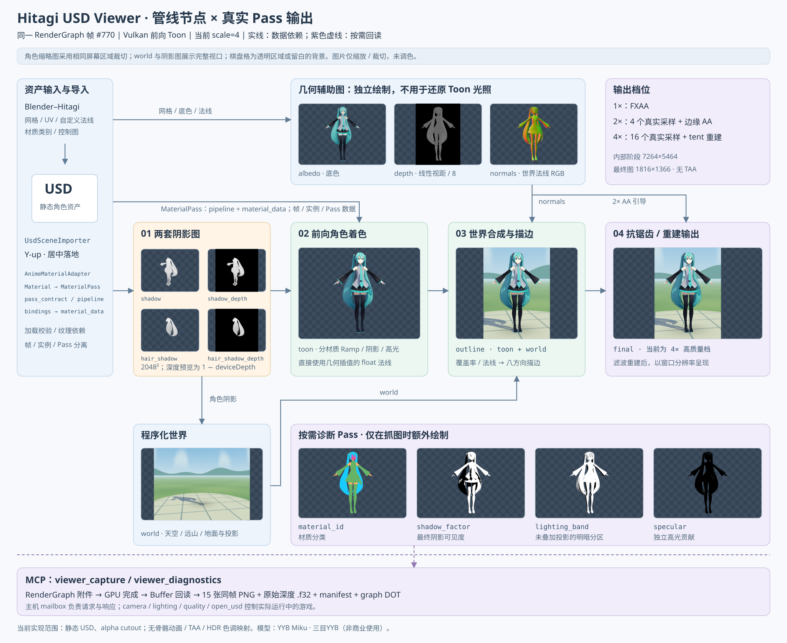

# USD Anime Viewer

原生 Hitagi game：加载静态 USD 角色，在程序化天空、远山和地面展台中渲染分材质卡通光照、角色软阴影、边缘光与描边。默认 2 倍宽高超采样，解析后对几何边缘额外抗锯齿；1 倍模式使用 FXAA。
右上角通过 PocketJS GUI 显示最近半秒的平均 FPS，按完成的渲染帧统计，最小化时重置采样。HUD 适配窗口尺寸和 DPI；MCP 的 `final` 图包含 HUD，诊断数据中的 `fps` 返回同一统计值。
全身远景可通过 `viewer_set_quality(scale=4)` 切到高质量档：每个输出像素有 16 个真实几何采样，使用 tent 滤波重建最终图，减轻睫毛、裙边和细发束的断续感。该档内部像素数为 2 倍档的四倍，最终图片尺寸不变。
默认使用免费的千驮谷 Shino 模型。它是参考二次元游戏明暗关系的基础 toon 实现，并非原神着色器的复刻。

已有可安装的 [Blender–Hitagi 资产插件](../../tools/blender/README.md)：准备独立角色副本、调整法线、生成脸部控制图与发流图、导出可搬迁 USD 包并重载 viewer。增强版初音通过 `tools/blender/prepare_miku_asset.py` 在真实 Blender 中生成。

## 材质契约与数据边界

USD 导入后，宿主在 `Viewer::Load` 中用游戏侧 `AnimeMaterialAdapter` 将源参数转换为运行时 `Material`，共享材质只适配一次。`animeMaterial`、`diffuseColor` 等源字段只在这个阶段解析；Renderer 按契约查找 `MaterialPass`，使用其 `pipeline` 和已打包的 `material_data`。缺少契约或管线的材质跳过对应绘制，不在渲染时猜测字段或合成材质。

| Contract | RenderGraph 阶段 | 参与规则 |
| --- | --- | --- |
| `AnimeForward` | toon，以及四个材质诊断阶段 | 已适配的角色材质 |
| `AnimeAlbedo` | albedo、场景深度 | 已适配的角色材质 |
| `AnimeNormals` | normals | 已适配的角色材质 |
| `AnimeShadowCaster` | shadow、shadow_depth | 已适配的角色材质 |
| `AnimeHairShadowCaster` | hair_shadow、hair_shadow_depth | 加载时明确分类为头发的材质 |

`AnimeMaterialBindings()` 是材质布局的唯一来源：颜色、alpha 阈值、类型/贴图开关、头部局部坐标及两张贴图，按有序的带类型默认值绑定打包为 112 字节。Slang 的 `AnimeMaterialData` 声明从同一组 bindings 生成。`Material::Load` 负责管线/纹理加载和打包；`SetParameter` 使数据失效，下一次 Load 重建。图访问按该 Pass 的纹理绑定声明，包含默认值和异步占位纹理，不能用 bindless 句柄代替 RenderGraph 依赖。

相机、灯光及全局质量开关放在帧数据中，每帧上传一次；变换放在实例数据中；输出模式、阴影图和采样器放在 Pass 数据中。draw 记录只连接这些数据及 `material_data`。全屏世界、描边、降采样由 Renderer 自己组织，不作为角色 MaterialPass。`FrameImages.stages` 的字符串映射只用于 MCP 图像查找。

同一几何 Pass 的材质数据批量存放在一个 Buffer 中，每条 draw 通过 `material_offset` 读取自己的数据。偏移按实际材质字节数计算并对齐到 4 字节，支持不同大小的契约数据；不能用固定的 112 字节步长。该 Buffer 每 Pass 只映射一次，纹理依赖仍逐材质声明。同一 Pass 的完全相同访问由 RenderGraph 合并，合并时保留全部 shader stage 要求。

`viewer_diagnostics` / 抓图 manifest 会报告 `material_contracts`（参与绘制数、材质字节数）和 `material_binding_errors`。自动回归可用 `--headless` 隐藏窗口并禁用鼠标相机输入，GPU 渲染及 MCP 接口保持启用。

```powershell
xmake run usd-viewer-tests --gtest_output=xml:temp/usd-viewer/material-contract-tests.xml
xmake run usd-viewer-game assets/anime_viewer/yyb_miku/yyb_miku.usda --headless --width 1816 --height 1366
.local/usd-viewer/Scripts/python examples/usd_viewer/check_mcp.py --output temp/usd-viewer/material-contract-validation
```

契约测试覆盖源类型校验、头发投影参与规则、参数顺序无关的打包/缺省值、参数修改后的重打包、四个着色器入口的 DXIL/SPIR-V 编译，以及 Vulkan 下替换材质值/纹理/Pipeline 和移除契约后的实际 GPU 输出。测试三角形使用 16 位索引，真实 USD 角色使用 32 位索引。

本次重构使用相同相机和灯光对比 YYB 初音：2× 和 4× 档各 15 张阶段图均与重构前逐像素一致。比较记录为 `temp/usd-viewer/material-contract-after/comparison.json` 和 `temp/usd-viewer/material-contract-4x/comparison.json`；完整 MCP 回归结果位于 `temp/usd-viewer/material-contract-validation/`。这是图像一致性验证，未进行性能基准测试。

## 性能分析（Tracy）

性能分析以日常 Debug 配置为基线，直接在仓库默认配置中启用 Tracy，不使用额外的 `XMAKE_CONFIGDIR`。Debug 配置还会将 Slang 的优化级别设为 0，应通过 CPU/GPU 计时区分开销来源。构建使用两个并行任务；后台构建进程使用低优先级。

```powershell
Remove-Item Env:XMAKE_CONFIGDIR -ErrorAction SilentlyContinue
xmake f -m debug --toolchain=clang-cl --profile=y -c
xmake build -j 2 usd-viewer-game
```

使用与客户端匹配的 [Tracy v0.14.1](https://github.com/wolfpld/tracy/releases/tag/v0.14.1)。本机匹配的命令行工具位于 `C:/Users/zover/Desktop/tracy/`；`tracy-capture.exe -a 127.0.0.1 -o output.tracy -s 5` 可采集有限时长的 trace，`tracy-csvexport.exe -u output.tracy` 和 `-g output.tracy` 分别导出 CPU、GPU 事件。先启动采集器，再用 `xmake run usd-viewer-game assets/anime_viewer/yyb_miku/yyb_miku.usda --headless --frames 64 --bridge temp/usd-viewer/profile-debug/bridge` 运行 Viewer，避免弹出窗口、无限运行以及占用交互实例的 MCP 邮箱。正常性能采集不调用 MCP 抓图，否则会增加诊断 Pass 和 GPU 回读。

CPU 时间线包含 `Anime BuildGraph`、构建各几何/全屏 Pass、RenderGraph 编译/录制/提交、`RenderGraph Prepare Views`、`RenderGraph Retire Nodes`、`RenderGraph Reset`、`RenderGraph Clear Imports`、`RenderGraph GPU Wait`、`Vulkan Acquire Swapchain` 和 `Vulkan Present`。GPU 时间线沿用各 command buffer 的 Pass 名称。CPU 等待和 GPU 执行可能重叠，不能把两者相加当作帧时间。

2026-10-16 的 Debug 优化对照使用 YYB 初音、1280×900 输出、2 倍超采样、GUI 开启、隐藏窗口、BelowNormal 优先级，保留相同的 Tracy 内存/调用栈采集。每次运行 192 帧，舍去前 32 帧和末帧，统计 159 帧。材质 Buffer 合批、重复访问合并和顶点批量绑定后，每帧内存分配从 22,408 次降至 15,663 次，帧末暂存 Buffer 池从 173 个降至 27 个。最终版本两次复测约 30 ms/帧，修改前同配置基线为 45.66 ms/帧。该短采集受调度影响，不能直接当作可见窗口的 FPS 保证。

该轮验证通过 35 项 RenderGraph/bindless 测试（包含 DX12 和 Vulkan）及 5 项材质/着色器测试；材质测试覆盖不同数据长度、绘制顺序反转和运行时材质更新，15 张阶段图与改动前逐像素一致。原始 trace、逐事件 CSV、测试结果和图像比较位于 `temp/usd-viewer/debug-optimization/`，汇总见 `comparison.json`；性能采集与 MCP 抓图分开进行。

后续 `test-2.tracy` 的 4,973 次 Engine tick 中只有 559 次实际构图渲染，不能把空 tick 纳入渲染 FPS。最后 160 个渲染帧的完整间隔平均 21.94 ms（约 45.6 FPS），GPU Pass 合计约 1.13 ms，主要开销仍在 CPU。材质已持有的贴图 View 改用 `Read(view)` 声明图依赖，并减少 View 描述对象的中间移动后，Tracy 记录的分配由每帧 15,663 次降至约 12,700 次。依赖仍参与裁剪、冲突校验、屏障和资源保活。

`pmr::string` 使用引擎内存池并不等于没有 Debug 开销。当前 MSVC STL 的字符串移动还会分配迭代器调试 proxy；MemoryPool 原先又为每次池分配向普通 `std::unordered_set` 插入一个系统堆节点，另外还有 Tracy 内存、调用栈和锁事件。实际 MemoryManager 的预热微基准（固定逻辑 CPU、16 字节分配加释放、7 次取中位数）中，完整诊断约 1.07 μs；临时移除诊断、保留普通 mutex 的对照约 78 ns。现已将泄漏地址重建移至退出时，仅在存在泄漏时遍历页面和空闲链表，不再逐次登记。保留完整 Tracy 的修改后微基准约 0.54 μs；13 个跨页、复用及整页未释放的泄漏地址与数量均精确匹配。

2026-10-16 在构造参数优化仍保留时，Debug/Tracy 配置下两次同参数短采集为 13.95 和 13.17 ms/帧（约 72–76 FPS）；尚未达到 200 FPS 所需的 5 ms。此前同一组图优化的采集在 18.7–25.4 ms 间波动，因此这些数据不构成可见窗口 FPS 保证。该轮验证包括 53 项图形测试、5 项内存/Tracy 测试、5 项材质/着色器测试及 15 张逐像素一致的阶段图。分析、诊断脚本与汇总位于 `temp/tracy-test-2-analysis/`，该轮结果见 `results.json`；采集程序保留原有内存、调用栈和锁采集。

2026-10-17 已按要求撤回整组描述对象构造参数优化：`ResourceWithDesc` 恢复按值接收，GPUBufferView/TextureView 及 DX12、Vulkan、Mock 对应构造函数也全部恢复按值接收。内存池泄漏统计、材质合批、依赖合并等其他改动保持不变。相同 Debug/完整 Tracy、YYB、1280×900、2× 配置下，按“优化版两次、撤回版两次、再各两次”的顺序重新采集，每版本共统计 636 个预热后的帧：

| 指标 | 撤回前：引用参数 | 撤回后：按值参数（当前） |
| --- | --- | --- |
| 四次运行的平均帧时间 | 13.56 ms | 18.07 ms |
| 各次平均帧时间范围 | 12.19–16.81 ms | 17.51–18.33 ms |
| 平均帧时间折算 FPS | 73.7 | 55.3 |
| Tracy 每帧分配次数 | 约 12,701 | 约 14,713 |
| Prepare Views 平均时间 | 1.33 ms | 3.08 ms |

本次采集中，撤回版平均多 4.51 ms/帧；运行间存在明显波动，不能把这个差值视为固定开销或可见窗口 FPS 保证。当前代码保留撤回状态，63 项相关测试通过，15 张阶段图逐像素一致。各次原始采集在 `temp/usd-viewer/debug-optimization/round3-ctor-*`，源文件快照及完整对比见 `temp/tracy-test-2-analysis/constructor-revert/comparison.json`。

2026-10-16 的一次 `releasedbg` 对照采集使用 YYB 初音、1280×900 输出、2 倍超采样、GUI 开启、隐藏窗口、BelowNormal 优先级。64 帧中舍去前 16 帧预热及末帧，统计 47 帧：整帧墙钟平均 8.86 ms，CPU 构图 1.21 ms、图编译 1.18 ms、录制 1.37 ms、GPU 等待 1.52 ms；GPU `toon` 平均 0.54 ms，`outline` 0.19 ms，GUI 0.007 ms。这不是 Debug 性能基线，不能据此判定 Debug 的瓶颈。该结果包含 profiling 开销，可能受到其他游戏竞争资源的影响；隐藏窗口的呈现行为也不能代替可见窗口基准。

原始数据保存在 `temp/usd-viewer/profile-smoke/viewer.tracy`，CPU/GPU CSV 和 `summary.json` 位于同一目录。当前证据支持优先继续拆分 CPU 构图、图编译和资源准备成本，尚不足以把卡通着色判定为主要瓶颈。

## 运行

当前渲染数据流与 MCP 回读路径（[PNG](../../docs/assets/usd_viewer_pipeline.png)）。节点附有 RenderGraph 帧 #770 的全部 15 张真实阶段缩略图；角色图统一裁切，原图位于 `temp/usd-viewer/material-contract-4x/`，SVG 中的缩略图链接到这些本地文件：



在仓库根目录执行，沿用现有 XMake 配置：

```powershell
python -m venv --system-site-packages .local/usd-viewer
.local/usd-viewer/Scripts/python -m pip install -r examples/usd_viewer/requirements.txt
.local/usd-viewer/Scripts/python examples/usd_viewer/prepare_model.py
xmake build usd-viewer-game
xmake run usd-viewer-game
```

右键拖动环绕，滚轮缩放。命令行可指定其他文件：

```powershell
xmake run usd-viewer-game path/to/model.usda
xmake run usd-viewer-game --frames 3
```

### 初音未来

当前展示已换成三目YYB的 **YYB Hatsune Miku_default_1.0ver**，通过 Blender–Hitagi 插件转换：

```powershell
.local/blender-4.5.9-windows-x64/blender.exe --background --factory-startup --python-exit-code 1 --python tools/blender/prepare_yyb_miku_asset.py
xmake run usd-viewer-game assets/anime_viewer/yyb_miku/yyb_miku.usda --width 1816 --height 1366 --bridge temp/usd-viewer/live
```

来源：[作者 BowlRoll 配布页](https://bowlroll.net/file/284016)、[作者发布视频](https://www.bilibili.com/video/BV1Bg411D7Me/)。原包 SHA-256 为 `fe9c2054e6b333a5a6651913cc0f3bcdfc0da143e165a6ec0b0784dfecd3b607`。模型限定非商业使用；三种语言的原说明与来源记录保留在本地资产目录，第三方模型不加入 Git。

生成可编辑的 `assets/anime_viewer/yyb_miku/yyb_miku.blend` 和 USD 包，实际显示 **140,812 个三角形、37 个材质、14 张打包贴图**。保留源法线、眼睛与头发贴图，增加脸部阈值图及材质色调。移除 MMD 专用重复 AO/假阴影层、透明辅助层与默认收起的眼镜，具体源材质编号记录在 `provenance.json`。当前为静态姿势，不包含动画、物理或 MMD 专用特效。

```powershell
.local/usd-viewer/Scripts/python examples/usd_viewer/check_mcp.py --scene assets/anime_viewer/yyb_miku/yyb_miku.usda --yaw 0.13 --pitch 0.04 --distance 2.8 --output temp/usd-viewer/yyb-full
```

`check_mcp.py` 可验证新模型的全部 15 个阶段；`check_quality.py` 中的几何数量和发流图断言针对旧 Animasa 增强资产，不能直接用于 YYB。

#### 旧版 Animasa 对照模型

下载并转换 Three.js MMD 示例中的 **Animasa（あにまさ）初音未来 ver.2.3**：

```powershell
.local/usd-viewer/Scripts/python examples/usd_viewer/prepare_miku.py
xmake run usd-viewer-game assets/anime_viewer/miku/miku.usda
```

脚本固定 Three.js r171 的提交与资源 SHA-256，生成 22,961 个三角形的静态 USD。源文件有 17 个材质，转换后将脸部皮肤、眼白拆分为独立材质，共 19 个；顶点位置与三角形总数不变。
保留原始姿势、眼睛贴图和材质底色，转换左右手坐标及 UV 原点；不导入 MMD 动画、物理、表情和专用 toon/sphere 贴图。
纯色材质直接使用 USD 的 `diffuseColor`，有贴图的材质使用纹理采样。

来源：[Three.js 中的原始模型目录](https://github.com/mrdoob/three.js/tree/2898f5b1ba10b1e94174c0a62d072f5f7b80442c/examples/models/mmd/miku)。角色版权为 CRYPTON FUTURE MEDIA, INC，建模与数据转换为あにまさ。
这些模型资源**不适用 Three.js 的 MIT 或 Shino 的 CC0 授权**，应遵守[原始使用说明](https://github.com/mrdoob/three.js/blob/2898f5b1ba10b1e94174c0a62d072f5f7b80442c/examples/models/mmd/Readme.txt)及模型随附说明。
下载的模型、USD、原始说明与 `provenance.json` 均保存在已忽略的 `assets/anime_viewer/miku/`，没有将第三方模型加入 Git。

保持 game 运行，可通过 MCP 热加载并验证：

```powershell
.local/usd-viewer/Scripts/python examples/usd_viewer/check_mcp.py --scene assets/anime_viewer/miku/miku.usda --yaw 0.13 --pitch 0.05 --distance 2.8 --light -0.6 0.8 -0.7 --output temp/usd-viewer/miku-front
```

`temp/usd-viewer/miku-front/final.png` 为最终图；同目录包含来自同一 Render Graph 帧的全部 15 阶段图像及验证结果。

USD host 使用现有 `UsdSceneImporter`，支持 USD/USDA/USDC/USDZ 中导入器可读取的静态 `UsdGeomMesh` 和 `UsdPreviewSurface` 底色/纹理。Y/Z 向上轴在 host 中统一为 Y-up；整体模型自动居中、落地，最长边归一化为 1.7 个展示单位。导入的相机和灯光不覆盖 viewer 的环绕相机和太阳光。

`usd-viewer-game-lib` 只依赖 engine，拥有游戏的渲染组合；`usd-viewer-game` 是附带 USD authoring 导入能力的宿主，额外依赖 editor。没有把 USD 或 MCP 依赖加入 engine。

## MCP 图像与诊断

先启动 game，再启动 stdio MCP adapter：

```powershell
.local/usd-viewer/Scripts/python examples/usd_viewer/mcp_server.py
```

客户端配置示例（路径替换为实际仓库位置，工作目录设为仓库根目录）：

```json
{
  "mcpServers": {
    "hitagi-usd-viewer": {
      "command": "E:/workspace/HitagiEngine/.local/usd-viewer/Scripts/python.exe",
      "args": ["E:/workspace/HitagiEngine/examples/usd_viewer/mcp_server.py"]
    }
  }
}
```

Lody 中可按上述 command/args 添加并选择此 MCP。仓库内的协议测试已直接连接该服务；这不意味着当前 Lody 会话已动态加载新 MCP。

| Tool | 用途 |
| --- | --- |
| `viewer_diagnostics` | 当前帧、场景、网格/三角形/draw 数、相机、光照、最近命令错误、瞬态资源池和 Render Graph DOT 文件 |
| `viewer_capture(stage)` | 获取指定阶段或 `all` 的新帧 PNG，返回真正的 MCP image content 和帧清单 |
| `viewer_set_camera` | 设置弧度制 yaw/pitch、距离和可选 target |
| `viewer_set_lighting` | 设置太阳方向和 0–4 像素描边宽度 |
| `viewer_set_quality` | `scale=1/2/4`，以及 `shadows`、`face_lighting`、`specular`、`asset_controls` 独立开关；默认 2 和全部 true；4 为全身远景高质量档 |
| `viewer_open_usd` | 运行中加载本地 USD 文件 |

可抓取的阶段：`shadow`、`shadow_depth`、`hair_shadow`、`hair_shadow_depth`、`albedo`、`normals`、`depth`、`material_id`、`shadow_factor`、`lighting_band`、`specular`、`world`、`toon`、`outline`、`final`。
`shadow` 是阴影 pass 的灰度颜色输出；`shadow_depth` 是实际阴影深度附件。`hair_shadow*` 只包含标记为头发的材质，用于脸部受影。
`depth` 的 PNG 表示线性视距除以 8，背景为黑；两种阴影深度 PNG 表示 `1 - deviceDepth`。三种深度同时保留无损 `.f32`：小端 float32、逐行紧密排列、范围 [0,1]、远平面/背景为 1。
普通颜色图是 RGBA8，`normals` 将世界法线从 [-1,1] 映射到 [0,1]，只用于诊断与描边，角色光照直接使用插值 float 法线。
`material_id` 用颜色标识普通材质/皮肤/脸/头发/眼睛；`shadow_factor` 表示材质实际采用的阴影可见度（包含脸部艺术调整），`lighting_band` 表示未叠加投影的明暗分区，`specular` 表示独立高光贡献。

`viewer_diagnostics.control_maps` 返回实际导入的控制图路径和尺寸。`asset_controls=False` 保留相同网格、法线与底色，绕过 Blender 导出的控制图，便于对照 `lighting_band` 和 `specular`。`check_quality.py --scene assets/anime_viewer/miku_hitagi/miku.usda` 额外验证控制图只影响对应材质。

`final` 尺寸等于窗口客户区；其他屏幕阶段尺寸为客户区乘 `scale`，两套阴影附件固定为 2048²。清单中的 `image_sizes` 给出每张图的实际尺寸。2 倍档先平均四个真实子像素，再按输出像素进行边缘过滤；4 倍档在高分辨率合成结果上直接做可分离 tent 重建，不再叠加方向性 FXAA。4 倍重建每轴覆盖八个源像素，正权重 `[1,3,5,7,7,5,3,1]/32`，双线性合并后使用 16 次纹理读取；这会略微软化极细细节，避免简单 box 缩小保留过多高频能量。它不是对最终 PNG 后期模糊。额外的四个诊断 geometry pass 只在抓图时构建，日常渲染不执行它们。

描边使用八方向圆形采样范围，线宽按输出像素计算，支持小数值；双线性覆盖率替代整数邻域的硬判定，减轻斜线的阶梯与宽度跳变。2 倍模式的额外抗锯齿只作用于轮廓覆盖率/法线突变附近，避免整张底色贴图被过滤；低反差处直接保留超采样颜色。该过程采用 [FXAA 的对比度与边缘方向过滤思路](https://developer.download.nvidia.com/assets/gamedev/files/sdk/11/FXAA_WhitePaper.pdf)，不是完整 FXAA Quality 实现，也没有时域累积。几何尖角、领口真实花边以及低分辨率贴图仍可能呈现离散细节。

请求通过原子重命名的本地 JSON mailbox 交给游戏主线程。game 构建 graph 时排入各附件的 buffer extraction，在 GPU 完成、graph 帧计数推进后才编码 PNG 并发布响应。`all` 的所有图像来自同一帧。这里不使用桌面或窗口截图。

结果保存在 `temp/usd-viewer/live/captures/<request-id>/`，包含图片、原始深度、`manifest.json` 和 `render-graph.dot`。MCP 只在请求时回读，不会每帧截图。game 和 adapter 都接受 `--bridge <directory>`；一个 mailbox 同时只连接一个 game。最小化窗口暂停渲染，恢复窗口后才能完成抓图。

## 验证

保持 game 运行：

```powershell
.local/usd-viewer/Scripts/python examples/usd_viewer/check_mcp.py --yaw 0.13 --output temp/usd-viewer/validated-front
.local/usd-viewer/Scripts/python examples/usd_viewer/check_mcp.py --yaw 0.85 --output temp/usd-viewer/validated-side
.local/usd-viewer/Scripts/python examples/usd_viewer/check_mcp.py --yaw 3.14 --output temp/usd-viewer/validated-back
```

脚本使用官方 MCP SDK 的 stdio client，验证 initialize、tools/list、tools/call、15 张 ImageContent、非空角色、底色/法线可见性一致、法线长度、原始深度、最终合成、输出尺寸、错误参数处理和失败更新不改变相机。它保存从 MCP 收到的 PNG 和 `image-checks.json`。通过 `--scene` 验证热加载，`--light x y z` 检查光照变化。

近景质量检查使用 `check_quality.py`，抓取正脸、侧脸、侧光、身体和全身，并分别关闭阴影、脸部光照、高光。检查关闭阴影后可见度为 1、关闭高光后高光附件为黑、脸部开关只影响脸部材质、各开关不改变底色。测试结束恢复原场景与相机设置。

```powershell
# 固定输出尺寸，便于与前一版 1816×1366 近景做同机位比较。
xmake run usd-viewer-game assets/anime_viewer/miku/miku.usda --width 1816 --height 1366
.local/usd-viewer/Scripts/python examples/usd_viewer/check_quality.py
# 本地存在原始对照图时可加：
# --before temp/usd-viewer/quality-analysis/face/final.png
```

输出在 `temp/usd-viewer/quality-validation/`，包含未经图片编辑的 GPU 抓图和 `quality-checks.json`。脸部内部拉普拉斯强度只能衡量明暗噪声，不能替代艺术质量评判。

描边专项检查对当前场景与机位执行，覆盖 1 倍/2 倍渲染、0/0.25/0.5/0.75/1 像素线宽、重复帧稳定性与阶段隔离，结束后恢复原设置：

```powershell
.local/usd-viewer/Scripts/python examples/usd_viewer/check_outline.py
```

输出在 `temp/usd-viewer/outline-validation/`。检查非零小数线宽确实生效且线条强度随宽度增长、零宽度为原始合成、修改描边不改变几何/光照/阴影附件；放大观感仍需人工复查。

切到 `viewer_set_quality(scale=4)` 后可检查高质量输出：

```powershell
.local/usd-viewer/Scripts/python examples/usd_viewer/check_mcp.py --output temp/usd-viewer/fullbody-aa-validated
.local/usd-viewer/Scripts/python examples/usd_viewer/check_resolve.py temp/usd-viewer/fullbody-aa-validated
```

后者对真实 `outline` 附件执行独立 CPU 稠密卷积，验证 GPU 重建的相位、边界和权重。1816×1366 输出对应 7264×5464 内部阶段。已有全身同机位对照与 15 阶段验证；未完成 GPU 性能评估，也没有实现运动矢量或 TAA。

## PC 渲染资料与实现取舍

调研日期：2026-10-16。参考公开演讲与作者的一手实现，区分官方思路、社区复现和本项目适配；不声称复现当前正式版游戏的完整 PC 管线。

| 资料 | 可核实的内容 | 本项目应用 |
| --- | --- | --- |
| [米哈游贺甲 / Unity Japan，Unite Tokyo 2018](https://www.slideshare.net/slideshow/unite-tokyo-20183rd/100634607)，第 22–37 页，主题涵盖 mobile 到 high-end PC | 材质 Ramp、减弱面部几何明暗、角色 PCSS、切线方向头发高光、材质色描边 | 独立皮肤/脸/头发/眼睛策略、双层头发高光、软阴影、较细的材质色描边。没有移植演讲里的整套 CG 渲染器 |
| [蔡浩宇，GDC 2021《Genshin Impact: Crafting an Anime-Style Open World》](https://gdcvault.com/play/1027539/-Genshin-Impact-Crafting-an) | 官方介绍动画风格、美术与角色/场景制作管线 | 角色与环境保留不同着色策略；该演讲不作为当前 PC shader 参数的证据 |
| [Stalomeow，逐物体阴影分析](https://km.stalomeow.com/p/per-object-shadow-improvement/) | 作者独立实现的光源空间包围盒和投影拟合，明确不代表官方实现 | 静态角色包围盒拟合 2048² 阴影，光源空间 texel 对齐，相机缩放不改变阴影投影 |
| [StarRailNPRShader v2.10 材质文档](https://srshader.stalomeow.com/v2.10/character/material/)及 [v2.10.3 Face shader](https://github.com/stalomeow/StarRailNPRShader/blob/v2.10.3/Shaders/Character/CharFaceCore.hlsl) | 社区实现按 Body/Face/Hair/Eye 区分材质；脸部使用头部方向与 FaceMap 阈值，另有头发投影 | 显式材质分类、眼睛保持可读性、单独头发 shadow map；初音没有 FaceMap，使用头部局部坐标的解析阈值场，不能称作原版 SDF |

角色改为前向着色：阴影、底色、法线等附件仍可检查，但 `toon` 在 geometry pass 中直接以 float 插值法线计算，避免 RGBA8 法线量化经过狭窄 Ramp 后形成色阶。
阴影使用 32 点遮挡物搜索、64 点双线性比较过滤，半影宽度随接收面与遮挡物的距离变化；这是定向光的简化 PCSS。等面积分层的黄金角采样盘固定在光源空间，不添加逐帧随机抖动；搜索半径覆盖最大过滤半径，避免漏掉附近的小遮挡物。参考 [NVIDIA PCSS 示例的采样预算](https://developer.download.nvidia.com/SDK/10.5/direct3d/Source/PercentageCloserSoftShadows/doc/PercentageCloserSoftShadows.pdf)，具体采样盘为本项目实现。投射端斜率偏移以及接收端法线/深度偏移按当前归一化展示场景调节，极薄表面仍可能漏光。

YYB 右肩旧版斑驳来自耳机投影的稀疏软阴影采样：几何射线确认该区域有耳机遮挡，不能简单用增大 bias 或关闭皮肤阴影消除。增加采样后保留连续的柔和投影；同机位验证底色、法线、深度和明暗分区未变，并检查正面、侧面、侧光与全身。新过滤增加纹理读取成本，尚未做完整 GPU 性能分析。

转换器为固定初音资产写入额外的 `UsdPreviewSurface` 输入：`animeMaterial`（float：0 普通、1 皮肤、2 脸、3 头发、4 眼睛）与 `animeHead`（float4：模型局部头部中心 xyz、面部尺度 w）。脸部正面为局部 -Z、向上为 +Y，随模型矩阵变换。未标记的 USD 使用普通材质路径。当前 Miku 通过源 PMD 的头骨权重拆分脸部，通过静态位置拆分眼白，不是通用人体识别器。

默认 2 倍宽高超采样会让屏幕阶段的像素数与显存开销约为 1 倍模式的四倍。这一版优先改善 PC 近景画质；没有声称帧率提升，也没有实现 TAA、HDR/曝光/色调映射或完整的线性色彩管理。颜色 Ramp 仍按显示颜色进行艺术控制。

当前验证平台：Windows、clang-cl debug、Vulkan、RTX 5080。没有运行全仓库测试或全量静态分析。现有 DX12 后端的 D32 sampled-view 创建失败，因此这个宿主明确选择 Vulkan。

## 模型来源与范围

- 模型：pixiv / VRoid Studio beta 的 **Sendagaya Shino**，来自 [公开镜像的固定修订](https://github.com/madjin/vrm-samples/blob/e16eb187100149a315ad92c3c9968f1d5baa6c7d/vroid/beta/Sendagaya_Shino.vrm)。
- 下载文件内 VRM `meta.licenseName` 为 `CC0`；[镜像授权说明](https://github.com/madjin/vrm-samples#license)。这不表示后来发布的全部 VRoid 示例角色都使用 CC0。
- SHA-256：`1e177c1a7b14f783a9c48395831db8616260d3bddd4154cb2784b779adca49b5`。脚本检查哈希和授权字段，将原始元数据写入 `assets/anime_viewer/provenance.json`。
- 转换脚本烘焙一个双臂下垂的静态姿势，转换 UV 原点，导出 31,211 个三角形与材质贴图。生成资源位于 git 已忽略的 `assets/anime_viewer/`，由脚本重建。

目前不支持骨骼动画、USD 时间采样、完整 MaterialX 网络或排序半透明。Blender profile 支持可编辑脸部阈值图和 UV 切线空间发流图；未提供控制图时，仍使用解析脸部与头部 up 近似。自动生成的脸部图不是美术制作的 SDF。128² 眼睛贴图和原模型多边形轮廓仍限制近景效果。透明材质按 cutout 处理；天空、远山和地面是程序化环境，并非外部 HDR cubemap。通用 USD 场景的支持范围仍受现有 importer 限制。
